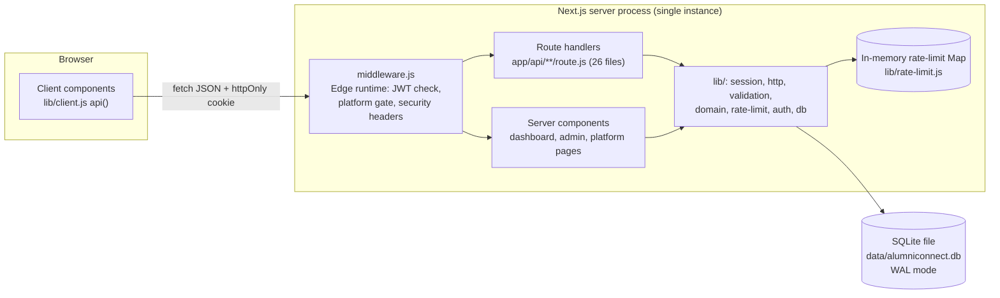
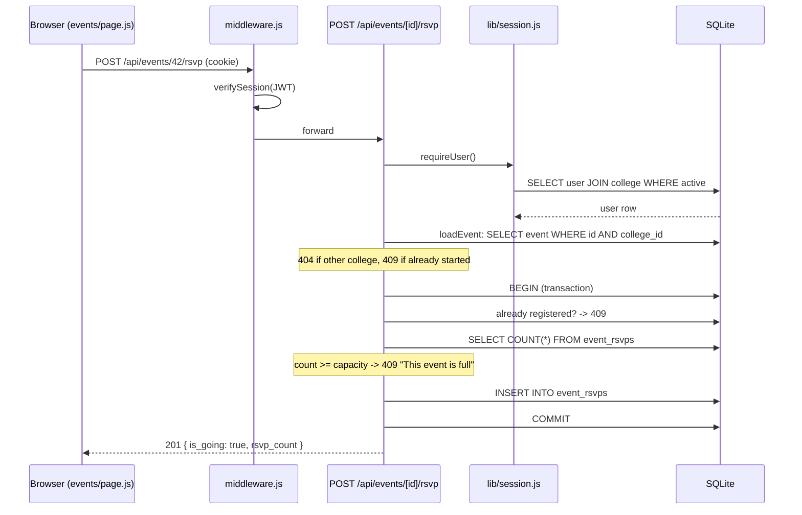

# AlumniConnect: architecture, design decisions, and measured results

This is the deep-dive behind the README. Every file path, function and number here was checked against the code at commit `2c27616` (`7989a52` plus the badge and admin-gate fixes). Numbers come from commands run on that code (see [Measured results](#5-measured-results)). Anything that could not be verified is marked `UNVERIFIED`.

Companion documents: [CODEBASE_GUIDE.md](CODEBASE_GUIDE.md) (file-by-file tour), [INTERVIEW_PREP.md](INTERVIEW_PREP.md) (revision sheet), [ALUMNICONNECT_INTERVIEW_GUIDE.html](ALUMNICONNECT_INTERVIEW_GUIDE.html) (interactive handbook).

## Contents

1. [Architecture](#1-architecture)
2. [The core pipelines in detail](#2-the-core-pipelines-in-detail)
3. [Why these technology choices](#3-why-these-technology-choices)
4. [Project structure](#4-project-structure)
5. [Measured results](#5-measured-results)
6. [Security](#6-security)
7. [Known limitations](#7-known-limitations)
8. [Remaining work](#8-remaining-work)
9. [Appendix: notable bugs fixed along the way](#9-appendix-notable-bugs-fixed-along-the-way)

---

## 1. Architecture

AlumniConnect is one Next.js 15 application (App Router) that serves both the React UI and a JSON REST API, backed by a single SQLite file opened in-process with `better-sqlite3`. There is no separate backend service, no queue and no cache server.



Boundaries:

- **Browser-facing:** everything. The browser talks to `middleware.js`, which forwards to either a page (server-rendered HTML) or a route handler (JSON).
- **Server-to-server:** none. The database is a library call inside the same Node process, not a network hop. The only outbound network access is Google Fonts at build time (`next/font/google` in `app/layout.js`).

### Persistence

| Data | Store | Why |
| --- | --- | --- |
| Colleges, users, profiles, connections, messages, jobs, events, RSVPs, mentorship requests, notifications (10 tables) | SQLite file at `DATABASE_PATH` (default `data/alumniconnect.db`), schema in `database/schema.sql` | Zero-setup ACID store with foreign keys and transactions; `npm install && npm run dev` works with no database server |
| Session identity | Signed JWT (HS256) in the `ac_session` httpOnly cookie (`lib/auth.js`) | Stateless check in Edge middleware; the DB is still consulted on every API call for role and active status |
| Login / register / password-change attempt counters | In-process `Map` (`lib/rate-limit.js`) | Simplest working limiter for one process; lost on restart and not shared between instances |
| Per-request user lookup | React `cache()` around `getCurrentUser` (`lib/session.js`) | One DB read per request even if several components ask for the user |
| UI state (search box, tabs, polling cursors) | React state in client components | Nothing needs to survive a reload |

### The central design idea

The JWT proves **who** you are; the database decides **what you may do right now**. Middleware does a cheap signature check and coarse role gating at the edge, and every route handler calls `requireUser()` / `requireRole()`, which re-reads the user, their role and their college's `is_active` flag from SQLite. Every data query then filters by the caller's `college_id` (multi-tenancy) or by the caller's own user id. Deactivating a user or a whole college therefore takes effect on the very next API request, without a token blacklist.

---

## 2. The core pipelines in detail

The technical heart of the project is not an algorithm but the request pipeline that every API call goes through. Five stages, all in the same process:

| Stage | Where | What happens | Parameters |
| --- | --- | --- | --- |
| 1. Edge gate | `middleware.js` | `verifySession()` checks the `ac_session` JWT signature and expiry with `jose`. Unauthenticated API calls get 401, unauthenticated `/dashboard/*` pages redirect to `/login?next=...`. College-admin routes are deliberately not role-gated here (the JWT role goes stale); `/api/platform` and `/dashboard/platform` need `superadmin`. Superadmins are confined to platform routes, `/api/auth/*` and `/dashboard/settings`. Adds four security headers. | Public API allowlist: `/api/auth/login`, `/api/auth/register`, `/api/auth/logout`, `/api/colleges` |
| 2. Error envelope | `handler()` in `lib/http.js` | Wraps every route. A thrown `HttpError` becomes `{ error, details? }` with its status; anything else is logged and returned as a generic 500. | none |
| 3. Identity re-check | `requireUser()` / `requireRole()` in `lib/session.js` | Reads the cookie again, verifies the JWT, then `SELECT`s the user joined to their college, requiring `u.is_active = 1` and (`superadmin` or `c.is_active = 1`). Missing -> 401; wrong role -> 403. | Wrapped in React `cache()` so it runs once per request |
| 4. Input validation | `readJson()` + `validate()` in `lib/validation.js`, `parseId()` / `getPagination()` in `lib/http.js` | Body must be a JSON object (else 400). Declarative rules trim, coerce and whitelist fields; failures throw 422 with a per-field `details` map. Path ids that are not positive integers 404. | Pagination default 20, max 50, overridden per route (profiles 12, jobs 10, admin users 15) |
| 5. Tenant-scoped business logic | route file + `lib/domain.js` | Parameterised SQL scoped by `college_id` or the caller's id. Cross-user actions go through `getColleague()`, which 404s if the target is in another college or inactive. Multi-row writes run in `transaction()`. Side effects such as `notify()` insert notification rows. | Role lists `CAN_POST_JOBS`, `CAN_CREATE_EVENTS`, `CAN_MENTOR` |

### The most important path: RSVP to a capacity-limited event

This is the path most likely to be probed, because it is the one place where concurrency matters.



Why it cannot overbook on one server: `better-sqlite3` is synchronous, so the count-then-insert inside `transaction()` runs to completion on the Node event loop before any other request's JavaScript runs, and SQLite holds a write lock for the insert. The `event_rsvps` composite primary key `(event_id, user_id)` independently prevents double RSVPs. Measured: 5 concurrent RSVPs to a capacity-1 event gave exactly one 201 and four 409s (`docs/smoke-check-output.txt`). With several processes on one file, the transaction is `BEGIN DEFERRED`, so a second writer would wait on `busy_timeout = 5000` or fail with `SQLITE_BUSY` rather than overbook; on PostgreSQL this would need `SELECT ... FOR UPDATE` on the event row or a conditional insert.

### Other flows worth knowing

- **Connection request** (`app/api/connections/route.js` POST): `getColleague()` -> transaction -> `findConnection()` in either direction. If the other user already sent a request, it is accepted instead of inserting a mirror row. The schema only has `UNIQUE (requester_id, addressee_id)`; the reverse-direction duplicate is prevented in this code.
- **Mentorship** (`app/api/mentorship/[id]/route.js`): a `TRANSITIONS` table maps each action to who may do it, the required current status and the next status. Wrong actor -> 403, wrong state -> 409. Accepting also inserts or accepts a connection so the pair can message.
- **Messaging** (`app/api/messages/[userId]/route.js`): sending requires an accepted connection (403 otherwise). The client polls `GET ?after=<lastId>` every 4 s; the conversation list every 15 s; nav badges (`/api/summary`) every 20 s.
- **Login** (`app/api/auth/login/route.js`): validate -> rate-limit (key `login:<ip>:<email>`, 10 per 15 min) -> look up user -> `bcrypt.compare` against the real hash or a precomputed `DUMMY_HASH` so unknown emails cost the same time -> 401 / 403 checks -> sign JWT -> set cookie.

---

## 3. Why these technology choices

| Choice | Alternative considered | Why this one | Cost |
| --- | --- | --- | --- |
| Next.js 15 App Router (route handlers + server components) | Separate Express API + React SPA | One codebase, one deploy; server components can query SQLite directly for fast first paint (`app/dashboard/page.js`, `admin/page.js`, `platform/page.js`) | Front end and API scale and deploy together; Edge middleware cannot touch the DB |
| SQLite via `better-sqlite3` 12.5 | PostgreSQL | No server to install; synchronous API makes transactions simple and race-free inside one process; real foreign keys and CHECK constraints | Single writer, single host. Render free tier disk is ephemeral, so data resets on restart |
| `jose` for JWT | `jsonwebtoken` (used before the rebuild, see commit `dece944`) | Uses Web Crypto, so the same `verifySession()` runs in Edge middleware and in Node handlers | none significant |
| JWT in httpOnly cookie | Server-side session table | No DB hit in middleware; the per-handler DB re-check gives revocation anyway | Logout and password change do not invalidate a stolen token until it expires (7 days) |
| `bcryptjs`, cost 10 | native `bcrypt`, argon2 | Pure JS, no native build step beyond `better-sqlite3` | Slower than native; cost 10 is the low end of current advice |
| Hand-written `validate()` (`lib/validation.js`) | zod / yup | No dependency; produces exactly the `{ error, details }` shape the UI expects | Less expressive; no shared schema with the client |
| In-memory fixed-window rate limiter | Redis, sliding window | Zero infrastructure for a single process | Lost on restart, per-process, and keyed on a client-supplied header (see [Security](#6-security)) |
| Polling for chat and badges | WebSockets / Server-Sent Events | Works on any host including Render free tier; trivial to reason about | Up to 4 s latency and a steady stream of requests per open tab |
| Plain CSS with tokens in `app/globals.css` + CSS Modules | Tailwind, a component library | No build plugin; one design-token file | More hand-written CSS |
| `lucide-react` icons | inline SVG | Consistent icon set, tree-shaken | One more dependency |

---

## 4. Project structure

```
app/
  layout.js                 Root layout: IBM Plex fonts, ToastProvider
  page.js                   Landing page (server); redirects signed-in users to /dashboard
  login/page.js             Client; demo-account buttons; safeNext() open-redirect guard
  register/page.js          Client; loads /api/colleges, posts /api/auth/register
  not-found.js              404 page
  dashboard/
    layout.js               Server; getCurrentUser() or redirect, renders AppNav
    page.js                 Server; "Needs your attention", stats, latest jobs/events (direct SQL)
    directory/ connections/ messages/ jobs/ events/ mentorship/ notifications/
    profile/ settings/ people/[id]/
                            Client pages calling the JSON API
    admin/page.js           Server; college stats + <UserManagement/> (client)
    platform/page.js        Server; platform stats + <CollegesTable/> (client)
  api/                      26 route.js files, 38 exported handlers
    auth/{login,logout,register,password}
    profiles, profiles/me, profiles/[id]
    connections, connections/[id]
    messages, messages/[userId]
    jobs, jobs/[id]
    events, events/[id], events/[id]/rsvp
    mentorship, mentorship/[id]
    notifications, summary, colleges
    admin/users, admin/users/[id]
    platform/colleges, platform/colleges/[id], platform/colleges/[id]/admins
components/                 AppNav (polls /api/summary), ConnectButton, MentorshipRequestModal,
                            Modal, Toast, Avatar, Logo, ui.js (Empty/Error/Skeleton/Field/Pagination)
lib/
  auth.js                   signSession / verifySession (jose, HS256), cookie options, 7-day TTL
  session.js                getCurrentUser (cached), requireUser, requireRole
  db.js                     getDb (one handle on globalThis), all/get/run/transaction
  http.js                   HttpError, handler(), readJson, parseId, getPagination
  validation.js             validate(), PASSWORD_RULE, assertStrongPassword
  domain.js                 getColleague, findConnection, CONNECTION_STATUS_SQL, notify, role lists
  rate-limit.js             rateLimit (fixed window Map), clientIp
  client.js, hooks.js       Browser: api() fetch wrapper, useApi, useDebounce
  format.js                 Date parsing/formatting, initials, label maps
database/
  schema.sql                10 tables, 10 indexes, idempotent CREATE IF NOT EXISTS
  init.js                   openDatabase(): pragmas, out-of-date guard, apply schema, seed if empty
  seed.js                   Fictional demo data: 3 colleges, 21 users
scripts/db-reset.js         Deletes the DB (+ -wal/-shm) and re-seeds
middleware.js               Edge auth gate + security headers
render.yaml                 Render blueprint (free plan, Node 22, generated JWT_SECRET)
docs/                       This documentation set + smoke-check.mjs and its output
```

---

## 5. Measured results

The repository contains **no automated test suite, no benchmark and no CI**. Everything below was measured in this documentation session on Windows 11, Node v22.14.0, npm 11.2.0, at commit `2c27616` (`7989a52` plus the badge and admin-gate fixes).

| What | Result | Source |
| --- | --- | --- |
| ESLint (`npm run lint`, `next/core-web-vitals`) | Exit 0, no warnings | command output |
| Production build (`next build`) | Succeeds; 33 static-generation steps; 49 s wall time on this machine | command output |
| Shared first-load JS | 103 kB; largest page `/dashboard/jobs` and `/dashboard/messages` at 112 kB first load | `next build` route table |
| Middleware bundle | 40.1 kB | `next build` route table |
| End-to-end smoke and probe checks | **52 checks, all pass.** Two of them first failed as probes and confirmed real defects, fixed since (appendix, items 6 and 7) | `node docs/smoke-check.mjs` -> `docs/smoke-check-output.txt` |
| Concurrent RSVP to a capacity-1 event (5 users) | 1 x 201, 4 x 409 | same |
| Size of the code | 26 route files, 38 handlers, 16 pages, 10 tables, 5 roles | `git ls-files` + grep |

How to read the smoke numbers: it is a single sequential script (except the RSVP race) against one fresh seeded database on one process. It proves the happy paths, the main permission boundaries (including the admin page redirect for non-admins) (cross-college 404, role 403, deactivation 401), validation (400/422), the event capacity guard and the login rate limit. It does not prove behaviour under load, across multiple server instances, in the UI, or on PostgreSQL. It is not a regression suite: it lives in `docs/`, is not wired to `npm test`, and must run against a freshly seeded database because it mutates data.

`INTERVIEW_NOTES.md` (untracked, in the repo root) says "140 end-to-end checks, all passing". No such script or output exists in the repository, so that number is `UNVERIFIED`. Use 52 / 52 from `docs/smoke-check-output.txt` instead, or recreate the 140-check script.

What should be measured next: p50/p95 latency of `/api/profiles` and `/api/messages/[userId]` under concurrent polling, SQLite write throughput with WAL under concurrent message sends, and the number of polling requests per active user per minute (3 timers: 4 s, 15 s, 20 s means about 22 requests per minute with a chat open).

---

## 6. Security

### Implemented

| Control | Where | Notes |
| --- | --- | --- |
| Password hashing | bcryptjs cost 10 in `app/api/auth/register/route.js`, `admin/users/route.js`, `platform/colleges/[id]/admins/route.js`, `auth/password/route.js`; `database/seed.js` | 8-72 chars (bcrypt ignores bytes past 72), at least one letter and one digit (`assertStrongPassword`) |
| Session cookie | `lib/auth.js` `sessionCookieOptions()` | `httpOnly`, `SameSite=Lax`, `Secure` when `NODE_ENV=production`, 7-day max-age |
| Secret handling | `lib/auth.js` `getSecret()` | Throws in production if `JWT_SECRET` is unset; throws if shorter than 32 chars; dev fallback otherwise. Render generates it (`render.yaml`) |
| Algorithm pinning | `jwtVerify(..., { algorithms: ["HS256"] })` | Blocks `alg: none` / algorithm confusion |
| Revocation on deactivation | `lib/session.js` | User and college `is_active` re-read per request. Verified: deactivated user's existing token -> 401 |
| Multi-tenant isolation | `getColleague()` in `lib/domain.js`; `college_id = ?` in every college-scoped query | Cross-college ids return 404, not 403, so existence is not leaked. Verified for profile, connect and thread |
| Role-based access | `middleware.js` gates + `requireRole()`; `CAN_*` lists in `lib/domain.js` | Five roles: student, alumni, faculty, admin, superadmin |
| SQL injection | Every query uses `?` or `@named` parameters via `lib/db.js`. `LIKE` input escapes `\`, `%`, `_` with `ESCAPE '\'` | The two places that build SQL text (`profiles/me` PUT column list, `notifications` PATCH placeholders) only interpolate whitelisted field names or `?` markers |
| User enumeration | Same 401 message, and `bcrypt.compare` against `DUMMY_HASH` when the email is unknown | Registration still returns 409 for a taken email, which does enumerate |
| Rate limiting | `lib/rate-limit.js` | Login 10 per 15 min per IP+email; register 5 per 10 min per IP; password change 5 per 15 min per user |
| Open redirect | `safeNext()` in `app/login/page.js` | Only paths starting with `/` and not `//` |
| XSS | React escapes all output; no `dangerouslySetInnerHTML` in the repo; profile URLs must be http(s) | Verified: `javascript:` URL rejected with 422 |
| Security headers | `withSecurityHeaders()` in `middleware.js` | `X-Content-Type-Options`, `X-Frame-Options: DENY`, `Referrer-Policy`, `Permissions-Policy` |
| Privacy | `app/api/profiles/[id]/route.js` | Email hidden unless self, connected or admin; private profiles 404 for non-connections |

### Not implemented or weak

- **Rate-limit key trusts `X-Forwarded-For`.** `clientIp()` takes the first value of a client-supplied header. Verified: after 11 failed logins return 429, changing the header resets the limit. Behind Render's proxy the left-most value is still client-controlled.
- **No server-side session revocation.** Logout only clears the cookie; password change does not invalidate other sessions (verified: old token still works after a password change).
- **No Content-Security-Policy** header (verified absent).
- **No CSRF token or Origin check.** Protection relies on `SameSite=Lax`, which stops cross-site POSTs from other sites but not from a compromised same-site subdomain.
- **No email verification.** Anyone who can type an address on the college domain can register as that person; the domain check proves nothing about mailbox ownership.
- **Public demo credentials.** The seed creates a platform admin `platform@alumniconnect.dev` with `Password123!`, and `app/login/page.js` shows one-click demo logins. On the Render blueprint the demo data is seeded on every start (unless `SEED_DEMO_DATA=false`), so anyone can sign in as platform admin on a public deployment. Acceptable for a demo, not for real data.
- **No audit log** of admin actions; no "last admin" guard (an admin can demote or deactivate every other admin of the college).

---

## 7. Known limitations

| # | Limitation | Impact | Why it exists |
| --- | --- | --- | --- |
| 1 | Single process, single SQLite file, in-memory rate limiter | Cannot scale horizontally; limiter resets on restart | Chosen for zero setup |
| 2 | Polling instead of push | Up to 4 s chat latency; constant background requests | Works on any host |
| 3 | No automated tests or CI | Regressions are caught only by hand | Not built yet; README says so |
| 4 | Check-then-insert on email in register and admin create | Two simultaneous registrations for the same email: the second hits the `UNIQUE` constraint and, because `SqliteError` is not an `HttpError`, returns a generic 500 instead of 409. Found by reading the code, not reproduced | No `try/catch` mapping of `SQLITE_CONSTRAINT_UNIQUE` |
| 5 | `GET /api/messages/[userId]` marks messages read | A GET with side effects; prefetchers or retries change state | Convenience: opening the thread is "reading" |
| 6 | Conversation list (`/api/messages`) includes deactivated partners | Clicking one gives "Conversation unavailable" (404 from `getColleague`). Found by reading | List query has no `is_active` filter |
| 7 | Render free tier: ephemeral disk | All data resets to the demo seed on every restart or deploy | Free hosting; fix is a persistent disk + `DATABASE_PATH` |
| 8 | Schema changes need `npm run db:reset` | No migrations; existing data is lost on schema change | `database/init.js` only applies idempotent `CREATE IF NOT EXISTS` and refuses an old schema |
| 9 | Node engine claim | `package.json` and README say Node >= 18.18, but `better-sqlite3` 12.5 declares `node: 20.x - 25.x` | Engines field not updated after the dependency bump |
| 10 | No file uploads, password reset, email, moderation or search beyond `LIKE` | Feature gaps | Scope cut during the rebuild |

---

## 8. Remaining work

In priority order:

1. **Add a test suite.** Promote `docs/smoke-check.mjs` into `npm test` with an isolated `DATABASE_PATH` per run; add unit tests for `validate()`, `rateLimit()` and `normalizeDomain()` with Vitest; run lint, build and tests in GitHub Actions.
2. **Session revocation.** Add `users.token_version` (or `password_changed_at`), put it in the JWT, compare it in `getCurrentUser()`. Bump on password change and on "log out everywhere".
3. **Rate limiting that cannot be spoofed.** Trust `X-Forwarded-For` only from a known proxy hop (Render sets it; take the right-most untrusted value), add a per-email counter independent of IP, and move buckets to Redis when there is more than one instance.
4. **Email verification and password reset.** `email_tokens(user_id, purpose, token_hash, expires_at)` table, a mail provider, single-use hashed tokens.
5. **Map constraint errors.** In `handler()`, translate `SQLITE_CONSTRAINT_UNIQUE` into 409.
6. **PostgreSQL path.** Replace `lib/db.js` with a `pg` pool, convert `@named` params and `datetime('now')`, use `SELECT ... FOR UPDATE` for RSVPs, real migrations (e.g. node-pg-migrate).
7. **Push updates.** Server-Sent Events for messages and badges; Redis pub/sub when multi-instance.
8. **Security headers.** Add a CSP (Next.js nonce-based), `Strict-Transport-Security`.

---

## 9. Appendix: notable bugs fixed along the way

The history is short (5 commits), so these come from the diffs of `dece944` (rebuild) and `f5f0e52` (platform admin), cross-checked against the current code.

**1. The pre-rebuild app faked its writes.**
- Symptom: "Settings saved successfully!" and password changes appeared to work but nothing persisted.
- Root cause: at `efc62ee`, `app/dashboard/settings/page.js` and `app/login/page.js` used `setTimeout(...)` to simulate API calls.
- Fix: commit `dece944` replaced them with real handlers (`app/api/auth/password/route.js`, etc.) and the `api()` client in `lib/client.js`.
- Detected by: reading the code and noticing no network request was made.

**2. Two competing data layers.**
- Symptom: inconsistent schemas and query syntax.
- Root cause: at `efc62ee` there was `database/schema.sql`, a second inline schema in `lib/sqlite-db.js`, and `lib/db.js` rewriting PostgreSQL `$1` placeholders to SQLite `?` with a regex. `package.json` depended on both `pg` and `better-sqlite3`, and `src/pages/Server.js` was an unrelated Express + MongoDB server from a CRA app.
- Fix: one schema file, one `openDatabase()` in `database/init.js`, one thin `lib/db.js`; legacy `src/` removed.

**3. Adding a college-less role without breaking sign-in.**
- Symptom (would-be): a platform admin has no college, but `users.college_id` was `NOT NULL` and `getCurrentUser()` used an inner `JOIN colleges`, so such a user could never be loaded.
- Fix in `f5f0e52`: `college_id` became nullable with `CHECK ((role = 'superadmin') = (college_id IS NULL))`, the session query became a `LEFT JOIN` with `(u.role = 'superadmin' OR c.is_active = 1)`, and login checks `college_active` for everyone else.
- Follow-on: SQLite cannot alter a CHECK constraint in place, so `database/init.js` now detects a `colleges` table without `is_active` and throws "Database schema is out of date. Run `npm run db:reset`" instead of starting with a half-migrated DB.

**4. JWT library that could not run in middleware.**
- Root cause: the pre-rebuild code used `jsonwebtoken`, which depends on Node crypto and does not run in the Edge runtime that Next.js middleware uses.
- Fix: `jose` in `lib/auth.js`, shared by `middleware.js` and `lib/session.js`.

**5. Next.js 14 -> 15 upgrade.** `dece944` moved from `next ^14.0.4` to `^15.5.x` and React 18 -> 19 (verified in `package.json` diffs), which also required `await params` and `await cookies()` throughout. The reason given in `INTERVIEW_NOTES.md` ("critical CVEs including a Windows RCE") is `UNVERIFIED` from the repo.

**6. Nav badge disagreed with the Connections page (found and fixed while documenting).**
- Symptom: after an admin deactivated a user who had sent a connection request, the nav badge still showed 1 pending request while the Connections page showed none.
- Root cause: `app/api/summary/route.js` counted pending requests and unread messages without joining `users`, while `app/api/connections/route.js` filters `u.is_active = 1`.
- Fix: both sub-counts now join the other user and require `u.is_active = 1`.
- Detected by: a PROBE check in `docs/smoke-check.mjs` (badge 1, list 0); it now passes (0 and 0).

**7. Promoted admins locked out until re-login (found and fixed while documenting).**
- Symptom: a member promoted to admin got 403 on `/api/admin/users` and was redirected away from `/dashboard/admin`.
- Root cause: `middleware.js` gated `/api/admin` and `/dashboard/admin` on the role inside the JWT, which keeps the old role until the token is reissued at login. Demotion was already safe because `requireRole()` re-checks the database.
- Fix: the college-admin role gate was removed from middleware. Authorization is done only by `requireRole("admin")` in every `/api/admin` handler and by the role check in `app/dashboard/admin/page.js`, both against the database. The platform gate stays, because no route can promote anyone to `superadmin`.
- Detected by: a PROBE check (403 before, 200 after); a new check confirms a student is still redirected from `/dashboard/admin`.
