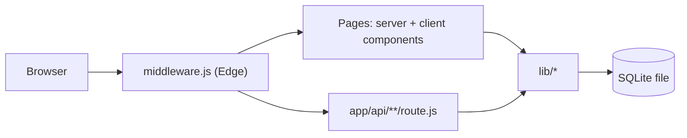
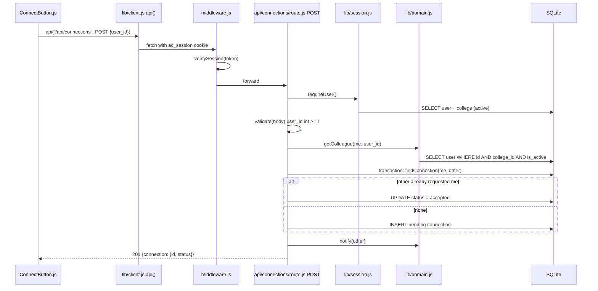
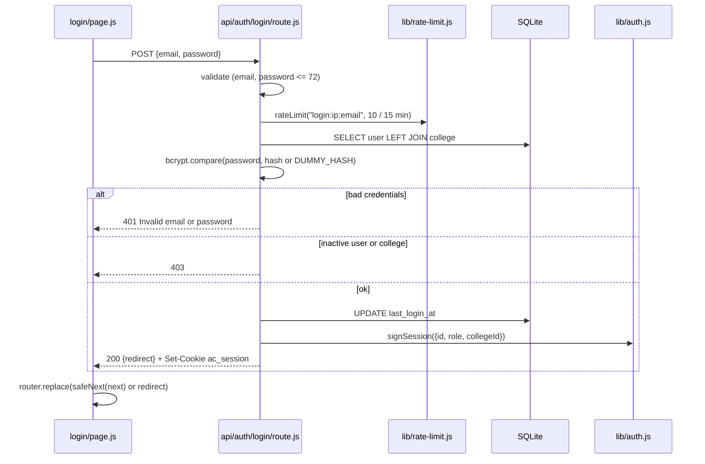

# AlumniConnect: Codebase Guide

A guided tour of the repository for revision. For every part of the code it answers three questions: *what is it, how does it connect to the rest, and what would I say about it in an interview*.

Facts match commit `2c27616` (`7989a52` plus the badge and admin-gate fixes). Numbers come from `docs/smoke-check-output.txt` and from commands run on that code (lint, build); see [ARCHITECTURE.md section 5](ARCHITECTURE.md#5-measured-results). Related: [ARCHITECTURE.md](ARCHITECTURE.md), [INTERVIEW_PREP.md](INTERVIEW_PREP.md), [ALUMNICONNECT_INTERVIEW_GUIDE.html](ALUMNICONNECT_INTERVIEW_GUIDE.html).

## Contents

1. [How to use this guide](#1-how-to-use-this-guide)
2. [The 60-second mental model](#2-the-60-second-mental-model)
3. [Repo map](#3-repo-map)
4. [Follow one request end to end](#4-follow-one-request-end-to-end)
5. [Backend, file by file](#5-backend-file-by-file)
6. [Frontend, file by file](#6-frontend-file-by-file)
7. [The ideas worth understanding deeply](#7-the-ideas-worth-understanding-deeply)
8. [Config and environment variables](#8-config-and-environment-variables)
9. [Tests: what they prove and what they can't see](#9-tests-what-they-prove-and-what-they-cant-see)
10. [Evaluation and the numbers](#10-evaluation-and-the-numbers)
11. [Bugs you found and fixed (your best stories)](#11-bugs-you-found-and-fixed-your-best-stories)
12. [What is still weak (say it before they do)](#12-what-is-still-weak-say-it-before-they-do)
13. [Run it, poke it, debug it](#13-run-it-poke-it-debug-it)
14. [Self-quiz](#14-self-quiz)
15. [Stale spots still in the repo](#15-stale-spots-still-in-the-repo)

---

## 1. How to use this guide

| Time available | Read |
| --- | --- |
| 10 minutes | Section 2, the headings of section 7, section 12 |
| 1 hour | Sections 2, 4, 7, 12, then the self-quiz (14) with answers covered |
| An evening | Everything in order, with the code open beside it. Run section 13 |
| The night before | Section 2, section 7 (say each interview sentence aloud), 11, 12, 14 |

Tip: after each section, close the guide and explain it aloud as if to an interviewer. If you cannot name the file and function, re-read that part of the code, not this guide.

---

## 2. The 60-second mental model

AlumniConnect does three jobs:

1. **Gatekeeping.** Decide who you are (JWT cookie) and what you may do right now (role and active status, re-read from the database).
2. **Tenant-scoped CRUD.** Directory, connections, messages, jobs, events, mentorship and notifications, each filtered to the caller's college.
3. **Two-level administration.** A college admin manages members of one college; a platform admin (superadmin) adds colleges, appoints their admins and switches whole colleges on or off.



Design idea in one sentence: **the token says who you are, the database says what you may do, and every query carries your college id.**

Why it is split this way: Next.js middleware runs on the Edge runtime, which cannot open a SQLite file, so it can only do cheap token checks. Everything that needs the database happens in Node route handlers and server components, which share the same `lib/` helpers. There is one process and one database file, so there is nothing else to coordinate.

---

## 3. Repo map

```
middleware.js          Edge: auth gate, platform role gate, security headers
app/
  api/                 26 route files (38 handlers): auth, profiles, connections, messages,
                       jobs, events, mentorship, notifications, summary, colleges, admin, platform
  dashboard/           Signed-in pages. layout.js loads the user and renders AppNav
    page.js            Home (server component, direct SQL)
    admin/             page.js (server) + UserManagement.js (client)
    platform/          page.js (server) + CollegesTable.js (client)
    */page.js          Client pages that call the API
  login/ register/     Auth pages (client)
  page.js              Landing page
components/            AppNav, ConnectButton, MentorshipRequestModal, Modal, Toast, Avatar, Logo, ui.js
lib/                   auth, session, db, http, validation, domain, rate-limit (server)
                       client, hooks (browser); format (both)
database/              schema.sql, init.js, seed.js
scripts/db-reset.js    Wipe and re-seed
render.yaml            Deployment blueprint
docs/                  This set + smoke-check.mjs
```

---

## 4. Follow one request end to end

### 4.1 Write path: send a connection request



1. `components/ConnectButton.js` `connect()` calls `api("/api/connections", { method: "POST", body: { user_id } })`.
2. `lib/client.js` `api()` sends JSON with `cache: "no-store"`; the browser attaches the `ac_session` cookie.
3. `middleware.js` `middleware()` runs `verifySession()` from `lib/auth.js`. `/api/connections` is not in `PUBLIC_API`, so a missing or bad token returns 401 here.
4. `app/api/connections/route.js` `POST` (wrapped in `handler()` from `lib/http.js`) calls `requireUser()` from `lib/session.js`, which re-reads the user and their college.
5. `validate()` from `lib/validation.js` checks `user_id`; self-connection is a 422.
6. `getColleague()` in `lib/domain.js` loads the target only if same college and active, else 404.
7. Inside `transaction()` (`lib/db.js`): `findConnection()` looks in both directions. Accepted -> 409 "already connected". I already sent -> 409 "Request already sent". They sent me one -> accept it. Otherwise insert a pending row.
8. `notify()` inserts a `notifications` row for the other user.
9. Response 201 `{ connection: { id, status } }`; the button switches to "Request sent" or "Message".

### 4.2 Read path: directory search

1. `app/dashboard/directory/page.js` keeps `q` in state and debounces it 300 ms with `useDebounce()` (`lib/hooks.js`).
2. An effect builds `URLSearchParams` (q, role, year, department, mentors, page) and calls `api("/api/profiles?...")`; a `cancelled` flag drops stale responses.
3. `app/api/profiles/route.js` `GET`: `requireUser()`, `getPagination()` (default 12, max 50), and `likeParam()` escapes `\ % _`.
4. One `where` string is reused for `COUNT(*)` and the page query. It filters `u.college_id = @college AND u.is_active = 1 AND p.is_public = 1 AND u.id <> @me`, `LEFT JOIN`s `connections` in either direction, and computes `connection_status` with `CONNECTION_STATUS_SQL` from `lib/domain.js`.
5. Two extra queries return distinct departments and years for the filter dropdowns.
6. The page renders cards with `ConnectButton` initialised from `connection_status`.

### 4.3 Auth: log in



1. `app/login/page.js` `signIn()` posts credentials (demo buttons post `Password123!`).
2. `app/api/auth/login/route.js` validates, then rate-limits **before** touching the database.
3. The user lookup `LEFT JOIN`s `colleges` so the college-less superadmin is found.
4. `bcrypt.compare` always runs, against `DUMMY_HASH` when the email is unknown, so timing does not reveal registered emails.
5. Inactive user -> 403; non-superadmin with inactive college -> 403.
6. `signSession()` puts `sub` (user id), `role` and `cid` (college id) in an HS256 JWT valid 7 days; the cookie options come from `sessionCookieOptions()`.
7. The response includes `redirect` (`/dashboard/platform` for superadmins). The page uses `safeNext()` to honour `?next=` only for same-site paths.

### 4.4 Admin flow: deactivate a member

1. `app/dashboard/admin/UserManagement.js` confirms, then `PATCH /api/admin/users/:id { is_active: false }`.
2. Middleware requires `session.role === "admin"` for `/api/admin/*` (from the JWT).
3. `app/api/admin/users/[id]/route.js` `requireRole("admin")` re-checks the DB, refuses self-changes (422), and loads the target only within `admin.collegeId` (404 otherwise).
4. `UPDATE users SET is_active = 0`. On the target's next request, `getCurrentUser()` finds no active row, so APIs return 401 and `app/dashboard/layout.js` redirects to `/login`. Verified in the smoke run.

### 4.5 Messaging with polling

1. `app/dashboard/messages/page.js` reads `?with=<userId>` and renders `<Thread key={activeId}>`, so switching conversations remounts and resets state.
2. Initial load: `GET /api/messages/:userId` returns up to 200 latest messages (`THREAD_LIMIT`), `canMessage`, and marks the other person's messages read.
3. Every 4 s (`THREAD_POLL_MS`): `GET ...?after=<lastIdRef>`; new rows are appended with a `Set` of seen ids to avoid duplicates (a sent message can also arrive via poll).
4. Sending: `POST /api/messages/:userId { body }`; the server requires an accepted connection (403 otherwise).
5. The conversation list reloads every 15 s (`LIST_POLL_MS`) and after activity; nav badges reload every 20 s (`POLL_MS` in `components/AppNav.js`) and on navigation.

---

## 5. Backend, file by file

### Edge

**`middleware.js`**
- Responsibility: authentication gate for all non-static paths, the platform (superadmin) gate, superadmin confinement, security headers.
- Key items: `PUBLIC_API`, `AUTH_PAGES`, `withSecurityHeaders()`, `config.matcher` (excludes `_next/static`, `_next/image`, `favicon.ico`, `robots.txt`).
- Depends on: `lib/auth.js` only (Edge-safe).
- Gotcha: anything it reads from the JWT can be stale. That is why it no longer gates `/api/admin` or `/dashboard/admin` on the token's role (a promoted admin used to be blocked until re-login); those are checked against the database by `requireRole("admin")` and `app/dashboard/admin/page.js`.

### lib (server)

**`lib/auth.js`**
- `signSession()`, `verifySession()`, `sessionCookieOptions()`, constants `SESSION_COOKIE = "ac_session"`, `SESSION_TTL_SECONDS` (7 days).
- `getSecret()` throws in production without `JWT_SECRET`, and for any secret under 32 chars.
- Used by middleware, login, register, logout and `lib/session.js`.
- Gotcha: `verifySession()` swallows all errors and returns `null`, so a misconfigured secret looks like "logged out".

**`lib/session.js`**
- `getCurrentUser` (React `cache()`), `requireUser()`, `requireRole(...roles)`.
- The query requires `u.is_active = 1 AND (u.role = 'superadmin' OR c.is_active = 1)`; returns `{ id, email, role, collegeId, collegeName, fullName }`.
- Used by every route handler and every server page.
- Gotcha: `cache()` dedupes per request only; there is no cross-request caching, so each API call costs one indexed primary-key lookup.

**`lib/db.js`**
- `getDb()` caches one `better-sqlite3` handle on `globalThis.__alumniConnectDb` so dev hot reloads do not leak handles.
- Helpers `all`, `get`, `run` prepare and run a statement; `transaction(fn)` wraps `db.transaction(fn)()`.
- Gotcha: statements are prepared on every call (no statement cache). Cheap for SQLite, but a known micro-optimisation.

**`lib/http.js`**
- `HttpError(status, message, details)`, `handler(fn)`, `json`, `readJson` (400 unless a JSON object), `parseId` (404 unless positive integer), `getPagination` (default 20, max 50).
- Gotcha: `handler()` turns any non-`HttpError` into 500, including SQLite `UNIQUE` violations (see section 12).

**`lib/validation.js`**
- `validate(input, rules, { partial })` supports `string`, `password` (not trimmed), `email` (lower-cased), `url` (http/https only), `int`, `bool`, `enum`, `datetime` (normalised to ISO).
- Returns only declared fields: a whitelist, which is what makes the dynamic `UPDATE` in `profiles/me` safe.
- `PASSWORD_RULE` (8-72), `assertStrongPassword()` (letter + digit).
- Gotcha: with `partial: true`, an explicitly empty value becomes `null` (or `false` for bool) and is written; omitted fields are left unchanged.

**`lib/domain.js`**
- `getColleague()`, `findConnection()`, `CONNECTION_STATUS_SQL`, `notify()`, `CAN_POST_JOBS`, `CAN_CREATE_EVENTS`, `CAN_MENTOR`, `JOB_TYPES`, `EVENT_TYPES`, `DOMAIN_RULE`, `normalizeDomain()`.
- Used by connections, mentorship, messages, profiles, events, jobs and platform routes.
- Gotcha: `CONNECTION_STATUS_SQL` assumes the query aliases the connection join as `c` and binds `@me`.

**`lib/rate-limit.js`**
- `rateLimit(key, { limit, windowMs })` fixed window in a `Map`; sweeps expired buckets when the map exceeds 10,000 keys. `clientIp()` reads `x-forwarded-for`, then `x-real-ip`, else `"local"`.
- Gotcha: successful attempts count too, and the IP comes from a client-controlled header (verified bypass).

**`lib/format.js`** (server and client)
- `parseDate()` treats SQLite `YYYY-MM-DD HH:MM:SS` as UTC; `timeAgo`, `formatDate`, `formatDateTime`, `initials`, `ROLE_LABELS`, `JOB_TYPE_LABELS`, `EVENT_TYPE_LABELS`.
- Gotcha: two timestamp formats coexist: `datetime('now')` (space, no zone) for `created_at`, ISO-8601 with `Z` for `events.starts_at`. Comparisons only ever compare like with like.

### Route handlers (`app/api`)

| Route file | Handlers | Notes |
| --- | --- | --- |
| `auth/login/route.js` | POST | Rate limit, dummy-hash compare, 401/403, sets cookie, returns `redirect` |
| `auth/register/route.js` | POST | Students and alumni only; active college; email must be the college domain or a subdomain; 409 if taken; signs in immediately |
| `auth/logout/route.js` | POST | Sets an empty cookie with max-age 0; not wrapped in `handler()` |
| `auth/password/route.js` | PUT | 5 per 15 min per user; verifies current password (422 if wrong) |
| `colleges/route.js` | GET | Public; active colleges for the sign-up form |
| `profiles/route.js` | GET | Directory search, pagination, filter values |
| `profiles/me/route.js` | GET, PUT | Partial update; builds `SET` from whitelisted keys; only alumni/faculty may set `open_to_mentor`; skills capped at 15 |
| `profiles/[id]/route.js` | GET | Private profile -> 404 unless self/connected/admin; email stripped unless self/connected/admin |
| `connections/route.js` | GET, POST | Lists accepted/incoming/outgoing (active users only); POST with mutual auto-accept |
| `connections/[id]/route.js` | PATCH, DELETE | Accept (addressee only, 409 otherwise); DELETE covers decline, withdraw and remove |
| `messages/route.js` | GET | Conversation list via CTE: latest message per partner + unread count |
| `messages/[userId]/route.js` | GET, POST | Thread with `?after=` cursor, marks read; POST only to accepted connections |
| `jobs/route.js` | GET, POST | Search, type, remote, mine, open/closed; POST for `CAN_POST_JOBS` |
| `jobs/[id]/route.js` | PATCH, DELETE | Poster or same-college admin |
| `events/route.js` | GET, POST | `when=upcoming|past|going`; computed `rsvp_count`, `is_going`, `can_manage`; POST requires future start |
| `events/[id]/route.js` | DELETE | Organizer or admin; notifies attendees in a transaction, then deletes (RSVPs cascade) |
| `events/[id]/rsvp/route.js` | POST, DELETE | Capacity check + insert in one transaction; 409 if started |
| `mentorship/route.js` | GET, POST | Mentor list with your latest active request status; POST requires `open_to_mentor` and no active request |
| `mentorship/[id]/route.js` | PATCH | `TRANSITIONS` state machine; accept also connects the pair |
| `notifications/route.js` | GET, PATCH | Latest 100; PATCH `{ids}` marks some (max 100), `{}` marks all |
| `summary/route.js` | GET | Nav badge counts; joins `users` so requests and messages from deactivated users are not counted |
| `admin/users/route.js` | GET, POST | Search members of own college; provision accounts (any of the 4 college roles) |
| `admin/users/[id]/route.js` | PATCH | `is_active`, `role`; not yourself; same college |
| `platform/colleges/route.js` | GET, POST | All colleges with member counts and admins; create college with normalised domain |
| `platform/colleges/[id]/route.js` | PATCH | Rename, change domain (409 on clash), activate/deactivate |
| `platform/colleges/[id]/admins/route.js` | POST | Promote an existing member of that college or create a new admin account |

### Database

**`database/schema.sql`** - 10 tables, 10 indexes, all `CREATE ... IF NOT EXISTS`. Key constraints: `users.email UNIQUE COLLATE NOCASE`; `CHECK ((role = 'superadmin') = (college_id IS NULL))`; `connections UNIQUE (requester_id, addressee_id)` and `CHECK (requester_id <> addressee_id)`; `event_rsvps PRIMARY KEY (event_id, user_id)`; status `CHECK`s on connections, jobs, mentorship; `ON DELETE CASCADE` everywhere.

**`database/init.js`** - CommonJS so both Next.js and `scripts/db-reset.js` can load it. `openDatabase()` creates the directory, sets `journal_mode = WAL`, `foreign_keys = ON`, `busy_timeout = 5000`, refuses an outdated schema, applies `schema.sql`, and seeds when `colleges` is empty unless `SEED_DEMO_DATA=false`.

**`database/seed.js`** - 3 colleges (Riverside inactive), 21 users across 5 roles, connections, messages, jobs, 6 events (the career fair is full at capacity 3), mentorship requests in every status, notifications. One bcrypt hash reused for all demo accounts. All in one transaction.

**`scripts/db-reset.js`** - deletes the DB and its `-wal` / `-shm` files, reopens (which re-seeds), prints the user count.

---

## 6. Frontend, file by file

### Shell

**`app/layout.js`** - root HTML, IBM Plex Sans/Mono via `next/font/google`, wraps everything in `ToastProvider`.

**`app/dashboard/layout.js`** - server component; `getCurrentUser()` or `redirect("/login")`. This second check catches deactivated accounts whose JWT middleware still accepts.

**`components/AppNav.js`** - client sidebar. Chooses links by role (superadmin sees only Colleges; admin gets Admin). Polls `/api/summary` every 20 s and on route change (skipped for superadmins). Logout posts `/api/auth/logout`, then `router.replace("/login")` and `router.refresh()`.

### Shared client helpers and components

**`lib/client.js`** - `api(path, { method, body })` throws `ApiError(status, message, details)`; on 401 outside `/api/auth/*` it redirects to `/login?next=<current path>`.

**`lib/hooks.js`** - `useApi(path)` returns `{ data, error, loading, reload }`; `useDebounce(value, 300)`.

**`components/ui.js`** - `EmptyState`, `ErrorState` (with retry), `SkeletonList`, `Field` (label + error/hint), `Pagination`.

**`components/ConnectButton.js`** - renders Connect / Accept request / Request sent / Message from `connection_status`. "Accept request" calls the same POST, relying on the server's mutual-accept logic.

**`components/MentorshipRequestModal.js`**, **`components/Modal.js`** (Escape to close, backdrop click, body scroll lock, `role="dialog"`), **`components/Toast.js`** (context, 3.5 s auto-dismiss, `aria-live="polite"`), **`components/Avatar.js`** (initials, strips "Dr"/"Prof"), **`components/Logo.js`**.

### Pages

| Page | Type | Talks to | Gotcha |
| --- | --- | --- | --- |
| `app/page.js` | Server | `getCurrentUser()` | `dynamic = "force-dynamic"`; signed-in users are redirected |
| `app/login/page.js` | Client | `/api/auth/login` | `safeNext()`; hard-coded demo accounts shown in every environment |
| `app/register/page.js` | Client | `/api/colleges`, `/api/auth/register` | Goes to `/dashboard/profile?welcome=1` on success |
| `app/dashboard/page.js` | Server | SQL directly | "Needs your attention" merges three queries and sorts by `created_at` string |
| `dashboard/directory/page.js` | Client | `/api/profiles` | Debounced search; resets to page 1 on filter change |
| `dashboard/connections/page.js` | Client | `/api/connections`, `/api/connections/[id]` | Decline/withdraw/remove are all DELETE |
| `dashboard/messages/page.js` | Client | `/api/messages*` | Three polling timers in total with the nav |
| `dashboard/jobs/page.js` | Client | `/api/jobs*` | Post form in a modal; owner sees close/reopen/delete |
| `dashboard/events/page.js` | Client | `/api/events*` | Converts `datetime-local` to ISO before sending; disables RSVP when full |
| `dashboard/mentorship/page.js` | Client | `/api/mentorship*` | Actions map 1:1 to `TRANSITIONS` |
| `dashboard/notifications/page.js` | Client | `/api/notifications` | Clicking marks read then `router.push(link)` |
| `dashboard/profile/page.js` | Client | `/api/profiles/me` | Strips `open_to_mentor` for roles that cannot mentor; the initial fetch has no `.catch`, so a failure leaves the skeleton showing |
| `dashboard/people/[id]/page.js` | Client | `/api/profiles/[id]` | Uses React `use(params)` |
| `dashboard/settings/page.js` | Client | `/api/auth/password` | Confirm-password check is client-side only |
| `dashboard/admin/page.js` + `UserManagement.js` | Server + client | SQL; `/api/admin/users*` | Server page re-checks `me.role !== "admin"` |
| `dashboard/platform/page.js` + `CollegesTable.js` | Server + client | SQL; `/api/platform/colleges*` | `router.refresh()` after changes to update server-rendered stats |

Styling: `app/globals.css` holds design tokens (neutral scale `--n-*`, `--accent: #1f6f5c`, spacing `--s*`) and utility classes; CSS Modules for nav, layout, landing and messages.

---

## 7. The ideas worth understanding deeply

### 7.1 Two-layer authorization

- **Problem:** a JWT cannot be revoked; it stays valid until it expires (7 days here).
- **Solution:** `middleware.js` verifies the signature (cheap, Edge). `requireUser()` in `lib/session.js` re-reads the user and college from SQLite on every API call and every dashboard render.
- **Alternative:** server-side session table checked in middleware, or short-lived access tokens plus refresh tokens.
- **Trade-off:** one indexed DB read per request. Middleware must not make authorization decisions from the token's role, because it goes stale; the college-admin gate was removed from middleware for exactly that reason.
- **Interview sentence:** "The token only proves identity; authorization is re-derived from the database on every request, so deactivating a user or a college takes effect on their next click."

### 7.2 Multi-tenancy by column, 404 not 403

- **Problem:** many colleges share one database; nobody may see another college's data.
- **Solution:** `college_id` on users, jobs and events; every college-scoped query filters by `me.collegeId`; `getColleague()` is the single gate for user-to-user actions. A row from another college is "not found".
- **Alternative:** database-per-tenant or PostgreSQL row-level security.
- **Trade-off:** isolation depends on every query remembering the filter; there is no database-enforced policy. Messages, connections and notifications are scoped by user id instead, and stay correct because the users at both ends were checked through `getColleague()` when the row was created.
- **Interview sentence:** "Tenant isolation is a shared-schema design with a college_id filter, and cross-tenant lookups return 404 so they don't even confirm the resource exists."

### 7.3 Race-free capacity check

- **Problem:** two people take the last seat at the same moment.
- **Solution:** in `app/api/events/[id]/rsvp/route.js`, count and insert run inside one `transaction()`. `better-sqlite3` is synchronous, so the whole transaction executes without yielding the event loop.
- **Alternative:** a conditional `INSERT ... SELECT ... WHERE (SELECT COUNT(*) ...) < capacity`, or `SELECT ... FOR UPDATE` on PostgreSQL.
- **Trade-off:** correct only while writes are serialised by one process plus SQLite's lock. Measured: 5 concurrent attempts on capacity 1 gave one 201 and four 409s.
- **Interview sentence:** "The check and the insert are one atomic unit; on Postgres I'd lock the event row or make the insert conditional."

### 7.4 Mutual connection requests

- **Problem:** A requests B while B already requested A; the schema's `UNIQUE (requester_id, addressee_id)` would allow both rows.
- **Solution:** `findConnection()` searches both directions inside a transaction; if B already asked, A's request accepts it.
- **Alternative:** store pairs canonically (`LEAST(a,b), GREATEST(a,b)`) with a unique index.
- **Trade-off:** the invariant lives in code, so the mentorship accept path also had to use `findConnection()`.
- **Interview sentence:** "Pair uniqueness in either direction is enforced in the transaction, and a crossing request becomes an accept instead of a duplicate."

### 7.5 Mentorship as a state machine

- **Problem:** many actions, each legal only for one party in one state.
- **Solution:** `TRANSITIONS` in `app/api/mentorship/[id]/route.js`: `{ by, from, to }` per action. Wrong actor -> 403, wrong state -> 409; `cancel` deletes.
- **Alternative:** nested `if`s per action.
- **Trade-off:** compact and auditable, but the status check and the update are not inside one transaction, so two simultaneous transitions could both pass the check (low risk, one process).
- **Interview sentence:** "Every legal move is one row in a table, so adding a state is a data change, and illegal moves get a 409."

### 7.6 Timing-safe login and enumeration

- **Problem:** if unknown emails return faster, an attacker can list registered users.
- **Solution:** `DUMMY_HASH` precomputed at module load; `bcrypt.compare` always runs; one generic 401 message.
- **Trade-off:** registration still says "An account with this email already exists" (409), so enumeration is possible there; rate limiting slows it.
- **Interview sentence:** "Login does the same bcrypt work whether or not the account exists, so response time doesn't leak which emails are registered."

### 7.7 One validator, one error shape

- **Problem:** consistent 4xx responses the UI can map to fields.
- **Solution:** `validate()` returns a whitelisted object or throws `HttpError(422, firstMessage, details)`; `handler()` turns it into `{ error, details }`; `ApiError` on the client exposes `details`; forms pass `errors.<field>` to `Field`.
- **Alternative:** zod schemas shared with the client.
- **Trade-off:** small and dependency-free, but validation rules are not shared with the browser.
- **Interview sentence:** "Every route speaks the same error dialect, so any form can show server-side field errors without custom code."

### 7.8 Schema on startup, and a guard for what can't migrate

- **Problem:** zero-setup local runs, but schema evolution.
- **Solution:** `openDatabase()` re-applies idempotent `schema.sql` on every start and seeds an empty DB. Because SQLite cannot alter a CHECK constraint, it detects the pre-platform-admin schema and throws with a "run db:reset" message.
- **Alternative:** a migration tool.
- **Trade-off:** fine for demo data; destroys data on schema change.
- **Interview sentence:** "The schema is applied idempotently at boot; there are no migrations yet, and the app fails loudly rather than run on an incompatible schema."

### 7.9 A constraint that encodes the tenancy rule

- `CHECK ((role = 'superadmin') = (college_id IS NULL))` in `users`: platform admins have no college and everyone else must have one. Bad data cannot be inserted even by a buggy route.
- **Interview sentence:** "The rule that only platform admins live outside a college is a database CHECK, not just application logic."

### 7.10 Cursor polling for chat

- **Problem:** near-real-time chat without WebSockets.
- **Solution:** the client remembers the last message id (`lastIdRef`) and asks for `?after=<id>`; ids are monotonic (`AUTOINCREMENT`), so no message is missed or repeated; a `Set` dedupes the optimistic append.
- **Trade-off:** latency up to 4 s; about 22 background requests per minute per user with a chat open.
- **Interview sentence:** "Polling uses the message id as a cursor, so each poll returns only new rows and is cheap with the (sender, recipient, id) index."

### 7.11 Server components for read-heavy pages

- `app/dashboard/page.js`, `admin/page.js` and `platform/page.js` query SQLite directly instead of calling their own API. No extra HTTP hop and no loading spinner on first paint; interactive pages stay client components with `useApi`.
- **Trade-off:** two code paths read the same data (SQL in pages and in routes) and can drift.

---

## 8. Config and environment variables

| Name | Default | Effect | Trade-off |
| --- | --- | --- | --- |
| `JWT_SECRET` | none; dev fallback string when `NODE_ENV` is not production | HS256 signing key; must be >= 32 chars | Changing it logs everyone out |
| `DATABASE_PATH` | `data/alumniconnect.db` (relative to cwd) | SQLite file location | On Render free tier, any path is ephemeral |
| `SEED_DEMO_DATA` | seeds unless `"false"` | Fill an empty DB with demo data | Demo data includes a public platform-admin login |
| `NODE_ENV` | set by Next.js | `production` makes the cookie `Secure` and requires `JWT_SECRET` | none |
| `NEXT_DIST_DIR` | `.next` | Build output folder (`next.config.js`) | Lets a test build coexist with a dev server |
| `NODE_VERSION` (Render) | `22` in `render.yaml` | Runtime on Render | none |

Constants in code:

| Constant | Value | Where | Trade-off |
| --- | --- | --- | --- |
| `SESSION_TTL_SECONDS` | 7 days | `lib/auth.js` | Longer = fewer logins, longer exposure of a stolen token |
| bcrypt cost | 10 | auth routes, seed | Higher = slower brute force and slower logins |
| Login limit | 10 / 15 min per IP+email | `auth/login/route.js` | Per-email key means an attacker rotating emails is not slowed |
| Register limit | 5 / 10 min per IP | `auth/register/route.js` | Shared NAT users can block each other |
| Password-change limit | 5 / 15 min per user | `auth/password/route.js` | none |
| Rate-limit sweep threshold | 10,000 keys | `lib/rate-limit.js` | Memory bound vs sweep cost |
| `THREAD_POLL_MS` / `LIST_POLL_MS` / `POLL_MS` | 4 s / 15 s / 20 s | messages page, AppNav | Latency vs request volume |
| `THREAD_LIMIT` | 200 messages | `messages/[userId]/route.js` | Older history is not loadable |
| Pagination | default 20, max 50; profiles 12, jobs 10, admin 15 | `lib/http.js`, routes | none |
| `busy_timeout` | 5000 ms | `database/init.js` | How long a writer waits for the lock |

---

## 9. Tests: what they prove and what they can't see

There is **no test suite in the repository**: no `test` script in `package.json`, no test files, no CI config. `npm run lint` is the only automated check and passes with no warnings.

This documentation session added `docs/smoke-check.mjs`, an end-to-end script against a running production build on a fresh database. Result: 52 checks, all pass (`docs/smoke-check-output.txt`).

What it proves: middleware 401/redirect, the admin page redirect for non-admins, security headers, cookie flags, login errors, 400/422 validation, cross-college 404s, role 403s, superadmin confinement, event capacity under 5 concurrent requests, mentorship 403/409, mutual-accept, connection-only messaging, `LIKE` escaping, immediate revocation on user and college deactivation, registration rules, `javascript:` URL rejection, and the login limiter.

What it cannot see: the UI (no browser tests), multi-instance behaviour, load, PostgreSQL, the dev-mode code paths, or the `UNIQUE` race in registration. It is order-dependent and mutates data, so it is a smoke check, not a regression suite.

Two checks started as probes for suspected defects (the badge count mismatch and the stale role in middleware). Both failed, the bugs were fixed, and both now pass (section 11).

---

## 10. Evaluation and the numbers

There are no product metrics, benchmarks or latency measurements in the repo. Measured in this session:

- Lint: exit 0, no warnings.
- `next build`: succeeds, 49 s on this machine; shared first-load JS 103 kB; middleware 40.1 kB.
- Smoke: 52 checks, all pass (two of them first failed and exposed bugs that are now fixed).
- Concurrency: 5 simultaneous RSVPs to a capacity-1 event -> 1 success, 4 x 409.
- Size: 26 route files, 38 handlers, 16 pages, 10 tables, 10 indexes, 5 roles, 21 seeded users in 3 colleges.

What to measure next: p95 latency of `/api/profiles` with 10k users (LIKE on four columns cannot use an index), SQLite write throughput under concurrent message sends, and polling load per active user.

---

## 11. Bugs you found and fixed (your best stories)

**Fake persistence in the original code.**
- Situation: settings and password forms showed success toasts.
- Root cause: `setTimeout` stubs instead of API calls (`app/dashboard/settings/page.js` at `efc62ee`).
- Fix: real route handlers plus `lib/client.js` `api()` in commit `dece944`.
- Lesson: a green toast is not evidence; check the network tab and the database.

**Two databases pretending to be one.**
- Situation: `lib/db.js` translated PostgreSQL `$1` placeholders to `?` with a regex, `lib/sqlite-db.js` had its own inline schema, `database/schema.sql` another, and `src/pages/Server.js` was an Express + MongoDB server.
- Fix: one schema, one `openDatabase()`, one thin `lib/db.js`; legacy `src/` deleted.
- Lesson: cut scope to something coherent before adding features.

**A user with no college.**
- Situation: adding the platform admin.
- Root cause: `users.college_id NOT NULL` and an inner `JOIN colleges` in `getCurrentUser()`.
- Fix (`f5f0e52`): nullable `college_id` with a CHECK tying it to `superadmin`, `LEFT JOIN` plus `(u.role = 'superadmin' OR c.is_active = 1)`, and an out-of-date-schema guard in `database/init.js` because SQLite cannot alter CHECK constraints.
- Lesson: a new role is a data-model change, not a new string in an enum.

**JWT library vs Edge runtime.**
- Root cause: `jsonwebtoken` needs Node crypto; middleware runs on Edge.
- Fix: `jose` in `lib/auth.js`.
- Lesson: know which runtime each file runs in.

**Nav badge vs Connections page (found and fixed while documenting).**
- Situation: after deactivating a user who had a pending request, the badge said 1 and the Connections page said 0.
- Root cause: `app/api/summary/route.js` did not join `users.is_active`, unlike `app/api/connections/route.js`.
- Fix: both badge sub-counts (requests and unread messages) now join the other user and require `is_active = 1`.
- Lesson: two queries for the same concept drift; write a check that compares them.

**Promoted admins locked out (found and fixed while documenting).**
- Situation: a member promoted to admin got 403 on `/api/admin/users` until they logged in again.
- Root cause: `middleware.js` gated admin routes on the role inside the JWT, which only changes at login.
- Fix: removed that gate; `requireRole("admin")` in each handler and the role check in `app/dashboard/admin/page.js` decide, against the database. Platform routes keep their gate because nobody can be promoted to superadmin.
- Lesson: middleware should authenticate; authorization belongs where the current data is.

---

## 12. What is still weak (say it before they do)

1. **Rate limiter is spoofable** (verified): `clientIp()` trusts `X-Forwarded-For`; a new header value resets the counter.
2. **No session revocation** (verified): password change and logout leave existing tokens valid for up to 7 days.
3. **Registration race returns 500** (by reading): check-then-insert on email; `UNIQUE` violation is not mapped to 409.
4. **No tests, no CI.**
5. **Single process**: SQLite file and in-memory limiter.
6. **Public demo admin** on any deployment that seeds demo data.
7. **GET with side effects**: opening a thread marks messages read.
8. **Directory search is `LIKE '%q%'`** over four columns: full scan, fine at demo size.
9. **No CSP, no email verification, no password reset.**
10. **Engines mismatch**: Node >= 18.18 claimed; `better-sqlite3` 12.5 requires Node 20+.

---

## 13. Run it, poke it, debug it

Setup and run (verified on Node 22.14):

```bash
npm install
```

```bash
npm run dev
```

Open http://localhost:3000 and use a demo button. All demo passwords are `Password123!`.

Lint (verified, exit 0):

```bash
npm run lint
```

Fresh demo data (deletes your local DB):

```bash
npm run db:reset
```

Production build into a separate folder so it does not disturb a running dev server (verified):

```bash
NEXT_DIST_DIR=.next-check npx next build
```

Serve that build on a throwaway database (verified with a temp-folder path; on Windows use a path under `%TEMP%` instead of `/tmp`):

```bash
NEXT_DIST_DIR=.next-check DATABASE_PATH=/tmp/ac-check.db JWT_SECRET=0123456789abcdef0123456789abcdef npx next start -p 3457
```

Reproduce the published smoke numbers in a second terminal (verified; needs a fresh DB each run):

```bash
node docs/smoke-check.mjs
```

No-server smoke checks:

```bash
node -e "const p=require('path').join(require('os').tmpdir(),'ac-peek.db');const db=require('./database/init').openDatabase(p);console.log(db.prepare('SELECT role, COUNT(*) n FROM users GROUP BY role').all())"
```

```bash
curl -s -X POST localhost:3000/api/auth/login -H "Content-Type: application/json" -d "{\"email\":\"x\",\"password\":\"y\"}"
```

The first prints the seeded users per role without starting a server (admin 2, alumni 12, faculty 1, student 5, superadmin 1; verified). The second, with `npm run dev` running, should print a 422 body with `details.email`. Debug tips: route errors are logged as `[api] METHOD /path` by `handler()`; if every page bounces to `/login` in production, `JWT_SECRET` is missing or short (`verifySession()` hides the thrown error); if startup throws "Database schema is out of date", run `npm run db:reset`.

---

## 14. Self-quiz

1. **What runs in middleware and what does not?**
   Signature/expiry check of the JWT, the public-API allowlist, the superadmin gate for platform paths, superadmin confinement and security headers. College-admin authorization is not done there. Nothing that touches the database, because middleware runs on the Edge runtime.

2. **Where is the database opened, and how many connections exist?**
   `getDb()` in `lib/db.js` calls `openDatabase()` from `database/init.js` once per process and caches the handle on `globalThis`, so there is one connection per server process.

3. **What three pragmas are set and why?**
   `journal_mode = WAL` (readers do not block the writer), `foreign_keys = ON` (SQLite has them off by default) and `busy_timeout = 5000` (wait up to 5 s for a lock instead of failing).

4. **What is in the JWT?**
   `sub` = user id, `role`, `cid` = college id, `iat` and `exp` (7 days), signed HS256.

5. **Why is the user re-read from the database on every request?**
   So deactivation, role changes and college deactivation take effect immediately even though the JWT is still valid.

6. **A user from College A requests `/api/profiles/<id of a College B user>`. What happens?**
   404 "Profile not found", because the query filters `u.college_id = @college`. 404 rather than 403 so it does not reveal the user exists.

7. **How is SQL injection prevented in search?**
   All values are bound parameters, and `LIKE` input has `\`, `%` and `_` escaped with `ESCAPE '\'`, so `%` searches literally (verified: 0 results).

8. **How does `profiles/me` PUT build a dynamic UPDATE safely?**
   `validate()` returns only keys declared in `PROFILE_RULES`, so the column names interpolated into `SET` come from a whitelist; values are named parameters.

9. **What does `validate()` do with an empty optional string?**
   Stores `null` (or `false` for a bool) if the key was present; omits the key if it was absent. With `partial: true`, required checks are skipped.

10. **Why do login failures for unknown emails still call bcrypt?**
    To make response time the same as for a wrong password, so timing does not reveal which emails exist.

11. **What are the three rate limits?**
    Login 10 per 15 min per IP+email, register 5 per 10 min per IP, password change 5 per 15 min per user, all fixed-window in memory.

12. **How can the login rate limit be bypassed?**
    By sending a different `X-Forwarded-For` value, since `clientIp()` trusts it; also by rotating the email part of the key.

13. **What makes the RSVP capacity check safe?**
    The count and insert run in one `better-sqlite3` transaction, which is synchronous and holds the write lock, so no other request can interleave in the same process.

14. **What prevents a double RSVP independently of the code?**
    The composite primary key `(event_id, user_id)` on `event_rsvps`.

15. **What happens when A sends a connection request to B, who already requested A?**
    The POST finds B's pending row via `findConnection()` and accepts it instead of inserting a second row, and notifies B.

16. **Who can accept a connection via PATCH?**
    Only the addressee of a pending request; otherwise 409.

17. **List the mentorship transitions.**
    accept and decline: mentor, pending -> accepted/declined. complete: either party, accepted -> completed. cancel: mentee, pending -> row deleted.

18. **Why does accepting a mentorship touch the connections table?**
    Messaging requires an accepted connection, so acceptance creates one or accepts a pending one, letting the pair message.

19. **How does chat polling avoid duplicates?**
    It polls with `?after=<last message id>`, and `appendMessages()` filters ids already in a `Set`.

20. **Why can a platform admin not open `/dashboard/directory`?**
    Middleware redirects superadmins to `/dashboard/platform` for any page except `/dashboard/settings`, and returns 403 for college APIs; they have no college.

21. **Which database constraint encodes "platform admins have no college"?**
    `CHECK ((role = 'superadmin') = (college_id IS NULL))` on `users`.

22. **What happens to members when a college is deactivated?**
    `getCurrentUser()` requires `c.is_active = 1`, so their next request is 401; login returns 403; the college disappears from `/api/colleges`. No rows are deleted.

23. **Why is there no admin role check in middleware?**
    The JWT keeps the role from login, so a gate there blocked newly promoted admins until they signed in again. Authorization for `/api/admin` is done by `requireRole("admin")` against the database, which handles both promotion and demotion immediately.

24. **Why does `/api/summary` join `users`?**
    So the badge excludes pending requests and unread messages from deactivated users, matching the Connections page. Before the fix the badge could say 1 while the page showed 0.

25. **What happens if two people register the same email at the same instant?**
    Both pass the `SELECT 1 ... WHERE email = ?` check; the second insert violates `UNIQUE`, which `handler()` turns into a 500 rather than a 409.

26. **Why does `database/init.js` throw on an old database instead of migrating?**
    The old `users` table has a CHECK constraint that SQLite cannot alter in place, and the data is demo-only, so it asks for `npm run db:reset`.

27. **What would you change first to run two instances?**
    Move to PostgreSQL (shared state, row locks for RSVPs), move rate-limit buckets to Redis, and push or pub/sub for chat.

28. **Why does `lib/client.js` not redirect on 401 from `/api/auth/*`?**
    A 401 from login means wrong credentials, which the form must display, not a session expiry.

---

## 15. Stale spots still in the repo

| Where | Claim | Reality |
| --- | --- | --- |
| `README.md` line 25, `package.json` `engines` | "Requires Node.js 18.18 or newer" | `better-sqlite3` 12.5 declares `node: 20.x - 25.x`; `render.yaml` uses Node 22 |
| `README.md` line 11 | "every query is scoped to the user's college" | College-scoped tables are; messages, connections and notifications are scoped by user id, and platform queries are global by design |
| `README.md` line 13 | "Email addresses are shown only to your connections" | Also shown to admins (`app/api/profiles/[id]/route.js`) |
| `database/schema.sql` comment above `connections` | Pair uniqueness "enforced in app/api/connections/route.js" | Also relied on in `app/api/mentorship/[id]/route.js` via `findConnection()` |
| `INTERVIEW_NOTES.md` (untracked) section 3 and 12 | "140 end-to-end checks, all passing" | No such script or output in the repo: `UNVERIFIED`. The reproducible figure is 52 checks, all passing |
| `INTERVIEW_NOTES.md` section 7 item 4 | "revocation is immediate" | True for deactivation; not for password change or logout (token remains valid) |
| `INTERVIEW_NOTES.md` section 7 item 13 | Next.js upgrade fixed "critical CVEs (including a Windows RCE)" | The upgrade is in git history; the CVE claim is `UNVERIFIED` |
