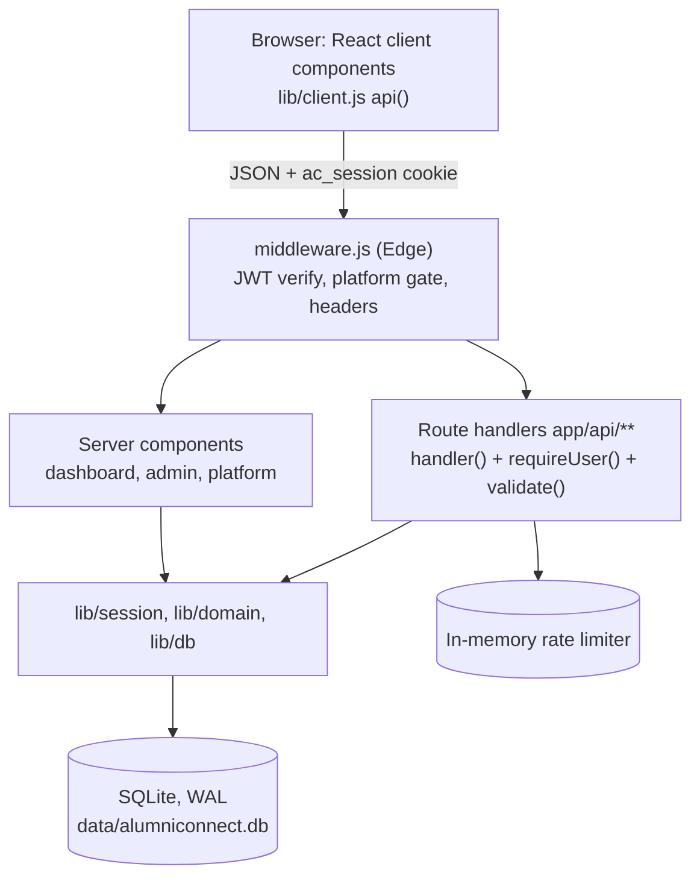

# AlumniConnect - Interview Revision Guide

A single-file revision sheet. Everything here comes from the code at commit `2c27616` (`7989a52` plus the badge and admin-gate fixes) and from the measurements in `docs/smoke-check-output.txt` (see [ARCHITECTURE.md section 5](ARCHITECTURE.md#5-measured-results)). Where something is missing or weak, it says so. For the file-by-file tour see [CODEBASE_GUIDE.md](CODEBASE_GUIDE.md).

## Contents

1. [The 30-second pitch](#1-the-30-second-pitch)
2. [What problem it solves](#2-what-problem-it-solves)
3. [System architecture](#3-system-architecture)
4. [Storage and the request pipeline](#4-storage-and-the-request-pipeline)
5. [Every key concept used, in one table](#5-every-key-concept-used-in-one-table)
6. [Config knobs](#6-config-knobs)
7. [Evaluation methodology and numbers](#7-evaluation-methodology-and-numbers)
8. [Auth and security](#8-auth-and-security)
9. [Bugs found and fixed (interview stories)](#9-bugs-found-and-fixed-interview-stories)
10. [Known limitations (say these yourself)](#10-known-limitations-say-these-yourself)
11. [How I would extend it](#11-how-i-would-extend-it)
12. [Interview Q&A bank](#12-interview-qa-bank)
13. [How to deliver the explanation](#13-how-to-deliver-the-explanation)
14. [Cheat sheet: numbers and file map](#14-cheat-sheet-numbers-and-file-map)

---

## 1. The 30-second pitch

> "Colleges lose touch with their graduates, and students have no private way to reach alumni for referrals or advice. AlumniConnect gives each college its own private network: you sign up with your college email, then search the directory, connect, message, share jobs, RSVP to events and request mentorship. One deployment serves many colleges, and a platform admin can onboard or switch off a college without touching anyone else. The part I'd like to talk about is the access-control design: the session token only proves who you are, and every request re-checks your role, your account and your college in the database, so revoking access is immediate, and every query is scoped to your college."

Tech stack: Next.js 15 (App Router, route handlers, server components), React 19, SQLite via better-sqlite3, jose (JWT), bcryptjs, plain CSS with design tokens, deployed with a Render blueprint.

---

## 2. What problem it solves

- **Who has it:** students who want referrals and advice; alumni who want to give back without a public inbox; college alumni offices that need a member list and engagement numbers.
- **Why existing approaches fall short:** LinkedIn is public and noisy and does not know who really belongs to a college. Ad-hoc WhatsApp or mailing lists have no directory, no permissions and no admin control. A per-college custom portal means separate infrastructure for each college.
- **What this does differently:** membership is gated by the college email domain, data is isolated per college, and one platform admin can onboard colleges and appoint their admins on shared infrastructure.

---

## 3. System architecture

One Next.js process serves pages and the JSON API. Middleware does the cheap work that does not need the database. Route handlers do the rest through shared helpers in `lib/`. Read-heavy pages (home, admin, platform) are server components that query SQLite directly; interactive pages are client components calling the API. There is no other service.

---

## 4. Storage and the request pipeline

### 4.1 Storage (`database/schema.sql`, `database/init.js`)

| Table | Purpose | Notable constraint |
| --- | --- | --- |
| `colleges` | Tenants | `domain UNIQUE COLLATE NOCASE`, `is_active` |
| `users` | Accounts | `email UNIQUE COLLATE NOCASE`; role CHECK of 5 values; `CHECK ((role = 'superadmin') = (college_id IS NULL))` |
| `profiles` | 1:1 with users | `is_public`, `open_to_mentor` |
| `connections` | Requests and connections | `UNIQUE (requester_id, addressee_id)`, `CHECK (requester_id <> addressee_id)`; status pending/accepted |
| `messages` | 1:1 messages | `read_at` drives unread counts |
| `jobs` | Job posts per college | type CHECK, status open/closed |
| `events` | Events per college | `capacity` NULL = unlimited, `starts_at` ISO-8601 UTC |
| `event_rsvps` | Attendance | `PRIMARY KEY (event_id, user_id)` |
| `mentorship_requests` | Mentor workflow | status pending/accepted/declined/completed |
| `notifications` | In-app notifications | `is_read` |

All foreign keys `ON DELETE CASCADE`; 10 indexes on the hot lookups (college + role, messages by pair and unread, notifications per user, jobs by college/status/date, events by college/start, mentorship by mentor and mentee). `openDatabase()` sets WAL, foreign keys and a 5 s busy timeout, applies the idempotent schema on boot and seeds an empty DB.

### 4.2 Edge gate (`middleware.js`)

Verifies the JWT, returns 401 for APIs or redirects pages to `/login?next=...`, gates `/api/platform` + `/dashboard/platform` on `superadmin` (college-admin routes are authorized in the handlers, against the database), confines superadmins to platform pages, settings and auth APIs, and sets four security headers.

### 4.3 Error envelope and identity (`lib/http.js`, `lib/session.js`)

`handler()` converts `HttpError` into `{ error, details }` with the right status and anything else into a logged 500. `requireUser()` re-reads the user and college from SQLite (cached per request with React `cache()`); `requireRole()` adds a 403.

### 4.4 Validation (`lib/validation.js`)

`validate()` whitelists and coerces declared fields, returns 422 with per-field messages. `readJson()` gives 400 for non-object bodies; `parseId()` gives 404 for bad ids.

### 4.5 Tenant-scoped business rules (`lib/domain.js` and routes)

`getColleague()` is the only way to act on another user and enforces same college and active. Transactions wrap multi-step writes (connections, RSVPs, mentorship acceptance, event cancellation, account creation). `notify()` writes notification rows as a side effect.

---

## 5. Every key concept used, in one table

| Concept | Where in the code | One-line definition | Why it is here |
| --- | --- | --- | --- |
| Next.js App Router route handlers | `app/api/**/route.js` | Files exporting `GET`/`POST`/... functions become HTTP endpoints | API and UI in one codebase |
| Server vs client components | `app/dashboard/page.js` (server) vs `directory/page.js` (`"use client"`) | Server components render on the server and can read the DB; client components run in the browser | Fast first paint for read-heavy pages, interactivity elsewhere |
| Edge middleware | `middleware.js` | Code that runs before routing on a restricted runtime | Reject unauthenticated traffic early |
| JWT (HS256) | `lib/auth.js` | Signed, self-contained token with claims and expiry | Stateless identity usable in Edge middleware |
| httpOnly / SameSite cookies | `sessionCookieOptions()` | Cookie flags hiding the token from JS and from cross-site requests | XSS token theft and CSRF mitigation |
| bcrypt | auth routes, `database/seed.js` | Slow, salted password hash | Brute-force resistance |
| Timing-safe failure path | `DUMMY_HASH` in `auth/login/route.js` | Same work for unknown and known emails | Prevent user enumeration by timing |
| Fixed-window rate limiting | `lib/rate-limit.js` | Count attempts per key per time window | Slow password guessing and sign-up spam |
| RBAC | `requireRole()`, `CAN_*` lists | Permissions derived from a role | Five roles with different powers |
| Multi-tenancy (shared schema) | `college_id` filters, `getColleague()` | Many tenants in one database separated by a column | One deployment for many colleges |
| 404-instead-of-403 | `getColleague()`, profile and event lookups | Hide existence of other tenants' resources | No information leak across colleges |
| Parameterised SQL | `lib/db.js` helpers | Values bound separately from SQL text | SQL injection prevention |
| LIKE escaping | `likeParam()` in `profiles/route.js`, jobs, admin users | Escape `%`, `_`, `\` and declare `ESCAPE` | Literal search, no wildcard abuse |
| ACID transactions | `transaction()` in `lib/db.js` | All-or-nothing group of statements | RSVP capacity, connection accept, account creation |
| WAL journal mode | `database/init.js` | Write-ahead log so readers don't block the writer | Concurrent reads during writes |
| Constraints as invariants | CHECK / UNIQUE / composite PK in `schema.sql` | Database rejects invalid rows | Defense in depth behind the code |
| Idempotent schema | `CREATE TABLE IF NOT EXISTS` | Safe to re-run on every boot | Zero-setup start |
| State machine | `TRANSITIONS` in `mentorship/[id]/route.js` | Table of legal moves | Clear 403/409 semantics |
| Declarative validation | `validate()` | Rules object instead of hand-written checks | Consistent 422 responses |
| Cursor-based polling | `?after=<id>` in `messages/[userId]` | Ask only for rows newer than the last seen id | Cheap near-real-time chat |
| Pagination | `getPagination()` | `LIMIT`/`OFFSET` with page and total | Bounded responses |
| Debouncing | `useDebounce()` in `lib/hooks.js` | Wait until typing pauses | Fewer search requests |
| React `cache()` | `getCurrentUser` | Per-request memoisation on the server | One user lookup per request |
| Open-redirect guard | `safeNext()` in `login/page.js` | Only allow same-site relative paths | Phishing via `?next=` |
| Security headers | `withSecurityHeaders()` | nosniff, frame deny, referrer and permissions policy | Clickjacking and MIME sniffing |
| Soft delete / deactivation | `is_active` on users and colleges | Disable without deleting rows | Reversible admin actions |

---

## 6. Config knobs

| Knob | Value | Trade-off |
| --- | --- | --- |
| `JWT_SECRET` | required in production, >= 32 chars | Rotating it logs everyone out |
| `DATABASE_PATH` | `data/alumniconnect.db` | Must be on a persistent disk to keep data |
| `SEED_DEMO_DATA` | seeds unless `"false"` | Demo data includes public admin logins |
| Session TTL | 7 days (`lib/auth.js`) | Convenience vs exposure of a stolen token |
| bcrypt cost | 10 | Security vs login latency |
| Login limit | 10 per 15 min per IP+email | Spoofable IP part; email part allows rotation |
| Polling | thread 4 s, list 15 s, badges 20 s | Latency vs request volume |
| `busy_timeout` | 5000 ms | Wait vs fail under lock contention |

---

## 7. Evaluation methodology and numbers

There is no test suite, benchmark or CI in the repository. In this session I measured:

- **Lint:** `npm run lint` exit 0, no warnings.
- **Build:** `next build` succeeds (49 s here); shared JS 103 kB; middleware 40.1 kB.
- **End-to-end smoke:** `docs/smoke-check.mjs` against a production build on a fresh demo database: **52 checks, all pass**. Two of them began as probes that failed and exposed real defects (badge mismatch, stale role in middleware); both are fixed.
- **Concurrency:** 5 simultaneous RSVPs to a capacity-1 event -> 1 x 201, 4 x 409.

How to read it: the script proves permission boundaries and business rules on one process and one database. It says nothing about load, multi-instance behaviour, UI rendering or PostgreSQL. The figure "140 end-to-end checks" in `INTERVIEW_NOTES.md` has no artifact in the repo; do not quote it unless you recreate that script.

---

## 8. Auth and security

What is there:

- bcrypt (cost 10), password 8-72 chars with a letter and a digit.
- HS256 JWT in an `httpOnly`, `SameSite=Lax`, `Secure`-in-production cookie, 7 days; algorithm pinned on verify; secret required in production.
- Two-layer authorization: middleware token check, then DB re-check of user, role and college in every handler.
- Tenant isolation through `college_id` filters and `getColleague()`, with 404 across colleges.
- Parameterised SQL everywhere; `LIKE` escaping.
- Timing-equalised login; generic 401 message.
- Rate limits on login, registration and password change.
- `safeNext()` open-redirect guard; React escaping; http(s)-only profile URLs.
- Four security headers in middleware.

What is not, said plainly:

- Rate-limit IP comes from a client-controlled `X-Forwarded-For` header (verified bypass).
- No session revocation on logout or password change (verified).
- No CSP, no CSRF token or Origin check (relies on SameSite=Lax).
- No email verification or password reset.
- Demo data includes a platform-admin account with a published password.

---

## 9. Bugs found and fixed (interview stories)

1. **Faked saves in the original project.** Settings and password changes showed success toasts through `setTimeout` stubs (`app/dashboard/settings/page.js` at commit `efc62ee`). I replaced them with real handlers and a single `api()` client. Lesson: verify in the network tab and the database, not the UI.
2. **Two data layers.** The original had two SQLite schemas, a regex that rewrote PostgreSQL `$1` placeholders to `?`, dependencies on both `pg` and `better-sqlite3`, and an unrelated Express + MongoDB server in `src/`. I reduced it to one schema file, one `openDatabase()` and one thin query helper.
3. **A role with no college.** Adding the platform admin broke two assumptions: `users.college_id NOT NULL` and an inner join to `colleges` in `getCurrentUser()`. I made `college_id` nullable with a CHECK that ties NULL to `superadmin`, changed to a `LEFT JOIN` with an explicit active-college condition, and added a startup guard because SQLite cannot alter a CHECK constraint.
4. **JWT library vs Edge.** `jsonwebtoken` does not run in Next.js middleware; switching to `jose` let one `verifySession()` serve both Edge and Node.
5. **Found and fixed while preparing:** I wrote probe checks for two suspicions and both failed. The nav badge counted requests from deactivated users (fixed with an `is_active` join in `app/api/summary/route.js`), and a newly promoted admin was blocked by a middleware gate that read the stale JWT role (fixed by removing that gate and relying on `requireRole("admin")`). Both checks pass now.

---

## 10. Known limitations (say these yourself)

- Single process: SQLite file and in-memory rate limiter. Scaling out needs PostgreSQL and Redis.
- Polling, not push: up to 4 s chat latency.
- No automated tests or CI in the repo.
- Login rate limit can be bypassed with a forged `X-Forwarded-For`.
- No session revocation; no email verification or password reset.
- A same-email registration race returns 500 instead of 409.
- Render free tier resets all data on restart.
- README says Node 18.18+, but `better-sqlite3` 12.5 needs Node 20+.

---

## 11. How I would extend it

1. **Tests in CI.** Turn `docs/smoke-check.mjs` into `npm test` with a temp `DATABASE_PATH`; Vitest unit tests for `validate()`, `rateLimit()`, `normalizeDomain()`; GitHub Actions running lint, build and tests.
2. **Session revocation.** `users.token_version` in the JWT, compared in `getCurrentUser()`, incremented on password change and "sign out everywhere".
3. **Email verification and reset.** `email_tokens(user_id, purpose, token_hash, expires_at, used_at)`, hashed single-use tokens, a mail provider; block login until verified.
4. **PostgreSQL + Redis.** Swap `lib/db.js` for a `pg` pool, convert named params and `datetime('now')`, add migrations, use `SELECT ... FOR UPDATE` or a conditional insert for RSVPs, move rate-limit buckets to Redis with a trusted-proxy IP.
5. **Real-time.** Server-Sent Events for new messages and badge counts, fed by Redis pub/sub across instances.
6. **Search.** SQLite FTS5 or PostgreSQL full-text search instead of `LIKE '%q%'` over four columns.
7. **Moderation and audit.** A `reports` table and admin queue; an `admin_actions` audit log; a guard that keeps at least one active admin per college.

---

## 12. Interview Q&A bank

### Project framing

**Q: What is AlumniConnect in one sentence?** A multi-college alumni network where each college's students, alumni and faculty get a private directory, messaging, jobs, events and mentorship, and a platform admin onboards colleges on shared infrastructure.

**Q: What did you personally build versus inherit?** The project started as a codebase that did not work: fake `setTimeout` saves, two database layers and leftover Express/MongoDB code. Commit `dece944` rebuilt the data layer, auth, all APIs and the UI; `f5f0e52` added the platform admin. I used AI assistance, and I reviewed and tested what went in; I can walk through any file.

**Q: What was the hardest part?** Deciding what to cut. The original had forums, maps, analytics and achievements that were mostly mock pages. I reduced it to a coherent core where every feature works end to end, then added the platform-admin layer, which forced a data-model change.

**Q: Why should an interviewer care about this project?** It shows access control done carefully: revocation without a token blacklist, tenant isolation, race-free capacity checks and consistent error semantics, all in a small codebase I can explain line by line.

**Q: What would you do differently if you started again?** Write the test script on day one and run it in CI, keep authentication-only logic in middleware and all authorization in handlers, and start on PostgreSQL with migrations if real users were expected.

**Q: Who are the users and what can each role do?** Students and alumni self-register; faculty and admins are created by an admin. Alumni, faculty and admins can post jobs and create events; alumni and faculty can mentor. College admins manage members of their own college; the platform admin manages colleges and appoints admins.

### Web and backend fundamentals

**Q: Why Next.js instead of a separate Express backend?** One codebase and one deploy, shared helpers between pages and API, and server components that can read the database directly for fast first render. The cost is coupling: the UI and API scale and deploy together.

**Q: What is the difference between a server component and a client component here?** `app/dashboard/page.js` is a server component: it runs SQL with `all()`/`get()` and sends HTML. `app/dashboard/directory/page.js` has `"use client"` and calls `/api/profiles` from the browser because it needs live filtering.

**Q: Why does the middleware not query the database?** Next.js middleware runs on the Edge runtime, which cannot load the native `better-sqlite3` module or open a file. So middleware only verifies the token, and database checks happen in Node route handlers.

**Q: How are errors returned?** Every handler is wrapped in `handler()` from `lib/http.js`. A thrown `HttpError` becomes `{ error, details }` with its status; unknown errors are logged with method and path and returned as a generic 500.

**Q: Which status codes do you use and when?** 400 for a malformed body or bad filter, 401 not signed in, 403 signed in but not allowed, 404 not found or in another college, 409 conflicts such as duplicate requests, a full event or an illegal state change, 422 validation failures with field details, 429 rate limited.

**Q: Why 422 and not 400 for validation errors?** 400 here means the request could not be parsed as a JSON object; 422 means it was well-formed but the values broke a rule. The UI uses the 422 `details` map to show errors next to fields.

**Q: How does pagination work?** `getPagination()` reads `page` and `limit` (default 20, capped at 50; routes override, for example 12 for the directory). The route reuses one `where` clause for `COUNT(*)` and the `LIMIT/OFFSET` query and returns `{ page, limit, total, totalPages }`.

**Q: How does the client handle an expired session?** `api()` in `lib/client.js` sees a 401 from any non-auth endpoint and sets `window.location` to `/login?next=<current path>`. After login, `safeNext()` sends the user back only if the path is same-site.

### Data and SQL

**Q: Why SQLite? Isn't it a toy?** It is an ACID database with transactions, foreign keys and CHECK constraints, and it let the app run with `npm install && npm run dev`. The limit is a single host and a single writer at a time, which is the main reason it would move to PostgreSQL for real traffic.

**Q: Walk me through the schema.** Ten tables: colleges as tenants; users and a 1:1 profile; connections, messages, jobs, events with RSVPs, mentorship requests and notifications. Jobs and events carry `college_id`; social tables reference users. Cascading foreign keys and ten indexes on the common lookups.

**Q: How do you stop duplicate connections in both directions?** The schema has `UNIQUE (requester_id, addressee_id)`, which only covers one direction. The POST handler uses `findConnection()` to look both ways inside a transaction, and if the other person already asked, it accepts that request instead of inserting.

**Q: What does WAL mode give you?** Readers do not block the writer and the writer does not block readers, which matters because the app polls constantly while users write messages. Writes are still serialised.

**Q: Why is `foreign_keys = ON` set explicitly?** SQLite ships with foreign key enforcement off for backward compatibility; without the pragma, `ON DELETE CASCADE` would silently do nothing.

**Q: How do you prevent SQL injection when building the profile UPDATE dynamically?** The column names come from `Object.keys(data)`, and `data` is the output of `validate()`, which only returns keys declared in `PROFILE_RULES`. Values are bound as named parameters.

**Q: How does search work and how would it scale?** `LIKE '%term%'` over name, company, headline and skills, with wildcards escaped. A leading wildcard cannot use an index, so it is a full scan of the college's users; I would move to SQLite FTS5 or PostgreSQL full-text search.

**Q: How are schema changes handled?** They aren't migrated: `schema.sql` is applied idempotently on boot and `npm run db:reset` recreates the database. `database/init.js` detects the one known incompatible old schema and refuses to start with a clear message.

### Evaluation and testing

**Q: How do you know it works?** I ran a 52-check end-to-end script against a production build on a fresh database and all pass; two of those checks first failed and exposed real bugs, which I fixed. It covers authentication, cross-college isolation, roles, validation, capacity, the state machine and revocation. Lint passes and the production build succeeds.

**Q: Is there a test suite in the repo?** No. There is no `test` script and no CI; the smoke script lives in `docs/` and is not wired into `npm test`. Adding Vitest units and running the smoke script in CI is the first thing I would do.

**Q: How did you test the race condition on event capacity?** I created an event with capacity 1 and fired five RSVPs from five signed-in users with `Promise.all`. Exactly one got 201 and four got 409 "This event is full".

**Q: What do your tests not cover?** The UI, multi-instance deployment, load, PostgreSQL behaviour, and the registration race on a duplicate email. They also mutate data, so they must run on a freshly seeded database.

**Q: What would you measure in production?** p95 latency of directory search and thread polling, request volume from polling per active user (about 22 per minute with a chat open), SQLite lock waits, failed-login and 429 rates, and weekly active users per college.

### Systems and architecture

**Q: How would you scale this to many colleges and thousands of users?** Move to PostgreSQL with a connection pool, put rate limits and pub/sub in Redis, run several stateless Next.js instances behind a load balancer, replace polling with Server-Sent Events, and add full-text search. The code already isolates SQL in route files and `lib/db.js`, so the change is mostly mechanical.

**Q: What breaks first under load?** Polling volume and SQLite writes on one host. Every open chat polls every 4 s and every tab polls badges every 20 s, and all writes funnel through one file lock.

**Q: What happens if you run two instances against one SQLite file?** Rate limits would be per instance, the `globalThis` handle is per process, and writers would contend for the file lock; network file systems make SQLite locking unreliable. It is a single-instance design.

**Q: Why polling and not WebSockets?** It works on any host, including the Render free tier, and is easy to reason about. The cursor `?after=<id>` makes each poll cheap. The cost is latency and wasted requests; SSE would be my next step.

**Q: How does the event capacity check stay correct under concurrency?** Count and insert run in one `better-sqlite3` transaction. The driver is synchronous, so nothing else runs on the event loop mid-transaction, and SQLite's write lock serialises writers. On PostgreSQL I'd lock the event row with `SELECT ... FOR UPDATE` or use a conditional insert.

**Q: Why server components for the dashboard and admin pages?** They are read-heavy and need no interactivity on first paint, so querying the database directly avoids a client round trip and a loading state. The trade-off is that the same data is read in two places (pages and API routes) and can drift.

**Q: How is the mentorship workflow modelled?** As a transition table: accept and decline by the mentor from pending, complete by either party from accepted, cancel by the mentee from pending (deletes the row). Wrong actor gives 403 and wrong state gives 409, and accepting connects the pair so they can message.

**Q: What is a single point of failure here?** Everything: one process, one disk. On the free Render plan the disk is also ephemeral, so a restart resets data to the demo seed.

### Auth and security

**Q: JWTs can't be revoked. How do you ban a user?** The JWT only proves identity. `requireUser()` re-reads the user and their college on every request and rejects inactive ones, so a deactivated user gets 401 on their next API call. I verified that with an existing token.

**Q: Then is revocation fully solved?** No. Logout only clears the cookie and a password change doesn't invalidate other sessions; a stolen token works for up to 7 days unless the account is deactivated. A `token_version` column checked in `getCurrentUser()` would fix it.

**Q: Why store the token in an httpOnly cookie instead of localStorage?** JavaScript cannot read an httpOnly cookie, so an XSS bug cannot exfiltrate the token. `SameSite=Lax` stops other sites from sending it on cross-site POSTs, which covers the main CSRF case.

**Q: How do you prevent CSRF?** Only through `SameSite=Lax` and JSON APIs. There is no CSRF token or Origin check, so a compromised sibling subdomain could still make same-site requests. Adding an Origin check in middleware would be cheap.

**Q: How do you stop one college seeing another's data?** Every college-scoped query filters by the caller's `college_id`, and `getColleague()` is the single entry point for acting on another user. Cross-college lookups return 404, so the response doesn't confirm the resource exists. I verified profile, connect and thread lookups across colleges.

**Q: What is weak about your rate limiter?** It is in memory and per process, it counts successes as well as failures, and its IP comes from `X-Forwarded-For`, which a client can set. I verified that changing the header resets the login limit. I would trust only the proxy's appended value and add a per-account counter.

**Q: How do you prevent user enumeration at login?** Same error message for unknown email and wrong password, and `bcrypt.compare` runs against a dummy hash when the email doesn't exist, so timing matches. Registration still returns 409 for a taken email, which is a remaining enumeration path.

**Q: Why bcrypt with cost 10, and why the 72-character limit?** bcrypt is deliberately slow and salted. Cost 10 is a reasonable default for a demo; I'd raise it or move to argon2id in production. bcrypt ignores input past 72 bytes, so longer passwords are rejected rather than silently truncated.

**Q: What stops a `javascript:` link in a profile?** The `url` validator only accepts `http:` and `https:`, and React escapes all rendered text. I verified a `javascript:` LinkedIn URL is rejected with 422.

**Q: What happens if `JWT_SECRET` is missing in production?** `getSecret()` throws, so signing fails and `verifySession()` treats every token as invalid; nobody can log in. That is fail-closed, but the error is hidden by the catch in `verifySession()`, which makes it confusing to debug.

**Q: Is there anything insecure about the public demo?** Yes. The seed creates a platform admin with a published password and the login page has one-click demo buttons, so on any public deployment that seeds demo data anyone can sign in as platform admin. Fine for a portfolio demo, not for real data; `SEED_DEMO_DATA=false` turns it off.

**Q: What did your probes find in authorization?** Middleware used to gate admin routes on the role inside the JWT. Demotion was safe because `requireRole()` re-checks the database, but a promoted admin was blocked until they logged in again. I removed that gate so middleware only authenticates, and the database decides authorization.

### Frontend

**Q: How does the UI handle loading, empty and error states?** `useApi()` returns `{ data, error, loading, reload }`, and pages render `SkeletonList`, `EmptyState` or `ErrorState` with a retry button from `components/ui.js`.

**Q: How do forms show server-side validation errors?** `api()` throws `ApiError` with `details`; forms keep them in state and pass `errors.<field>` to `Field`, which renders the message under the input.

**Q: How do you avoid a request per keystroke in search?** `useDebounce(q, 300)` delays the query until typing pauses, and the effect uses a `cancelled` flag so a slow earlier response cannot overwrite a newer one.

**Q: How does chat avoid showing a message twice?** Sent messages are appended immediately and polling may return them again, so `appendMessages()` filters out ids already in a `Set`, and the poll cursor advances to the last id.

**Q: What accessibility work is there?** Labelled inputs via `Field`, `aria-current` on nav links, `role="dialog"` and Escape-to-close on modals, an `aria-live` toast region, `aria-busy` skeletons and screen-reader text on badge counts.

### Behavioral hooks

**Q: Tell me about a time you found a bug in your own work.** While preparing these docs I suspected the nav badge and the connections page disagreed, so I wrote a check that deactivates a user who had a pending request. The badge said 1 and the list said 0. The cause was a missing `is_active` join in `/api/summary`; I added the join and the check now passes.

**Q: Tell me about a trade-off you made deliberately.** Polling over WebSockets: it works on free hosting and is simple to reason about, at the cost of latency and request volume. I'd revisit it once there is a Redis-backed multi-instance setup.

**Q: How do you decide what to cut?** I kept features that could work end to end with real data and removed pages that were only mock UI. A smaller system that is correct is easier to extend than a large one full of stubs.

**Q: How did you use AI tools on this project?** As an accelerator for the rebuild, with me reviewing, running and testing the result. I'd rather say that plainly and show I can explain and change any file.

**Q: What are you most proud of?** That revocation and tenant isolation are structural: one helper for identity, one for cross-user access, and constraints in the schema, rather than checks sprinkled around that someone could forget.

---

## 13. How to deliver the explanation

| Segment | Time | Content |
| --- | --- | --- |
| Pitch | 20-30 s | The blockquote in section 1 |
| Architecture | 1-2 min | One process; middleware for identity; handlers re-check DB; college_id everywhere; SQLite file; server vs client components |
| Deep dive | 3-4 min | Pick one: two-layer auth and revocation, or the RSVP transaction, or tenant isolation with 404. Name the file and function |
| Numbers | 30 s | 52 checks all passing, two of which first failed and found real bugs I then fixed; 5 concurrent RSVPs to capacity 1 -> exactly 1 success |
| Limitation | 30 s | Single process + polling; no session revocation; spoofable rate-limit IP |
| Bug story | 1 min | The college-less superadmin (CHECK constraint + LEFT JOIN + startup guard) or the badge probe |

Rules of thumb:

- Stop talking when interrupted; answer the question asked, then offer to go deeper.
- Never claim a number you did not measure. Do not say "140 checks".
- When you don't know, say what you would measure and how.
- Name files and functions; it signals you know the code.
- Volunteer one limitation before they find it.

---

## 14. Cheat sheet: numbers and file map

Key numbers:

- 26 route files, 38 handlers, 16 pages, 10 tables, 10 indexes, 5 roles.
- Seed: 3 colleges (1 inactive), 21 users.
- Session 7 days; bcrypt cost 10; password 8-72 with letter + digit.
- Login 10 / 15 min per IP+email; register 5 / 10 min per IP; password change 5 / 15 min per user.
- Polling: thread 4 s, list 15 s, badges 20 s; debounce 300 ms; thread limit 200 messages.
- Pagination default 20, max 50 (directory 12, jobs 10, admin users 15).
- Smoke: 52 checks, all pass (2 began as failing probes; bugs fixed). RSVP race: 1 x 201, 4 x 409.
- Build: shared JS 103 kB, middleware 40.1 kB. Lint: clean.

| Concern | File |
| --- | --- |
| Auth gate, headers | `middleware.js` |
| JWT sign/verify, cookie | `lib/auth.js` |
| Current user, roles | `lib/session.js` |
| DB handle, transactions | `lib/db.js` |
| Error envelope, ids, pagination | `lib/http.js` |
| Validation, password rules | `lib/validation.js` |
| Same-college lookup, notify, role lists | `lib/domain.js` |
| Rate limiting | `lib/rate-limit.js` |
| Login | `app/api/auth/login/route.js` |
| Connections + mutual accept | `app/api/connections/route.js` |
| RSVP capacity | `app/api/events/[id]/rsvp/route.js` |
| Mentorship state machine | `app/api/mentorship/[id]/route.js` |
| Chat thread + polling cursor | `app/api/messages/[userId]/route.js`, `app/dashboard/messages/page.js` |
| Nav badges | `app/api/summary/route.js`, `components/AppNav.js` |
| College admin | `app/api/admin/users/*`, `app/dashboard/admin/*` |
| Platform admin | `app/api/platform/colleges/*`, `app/dashboard/platform/*` |
| Schema, boot, seed | `database/schema.sql`, `database/init.js`, `database/seed.js` |
| Smoke checks | `docs/smoke-check.mjs`, `docs/smoke-check-output.txt` |
